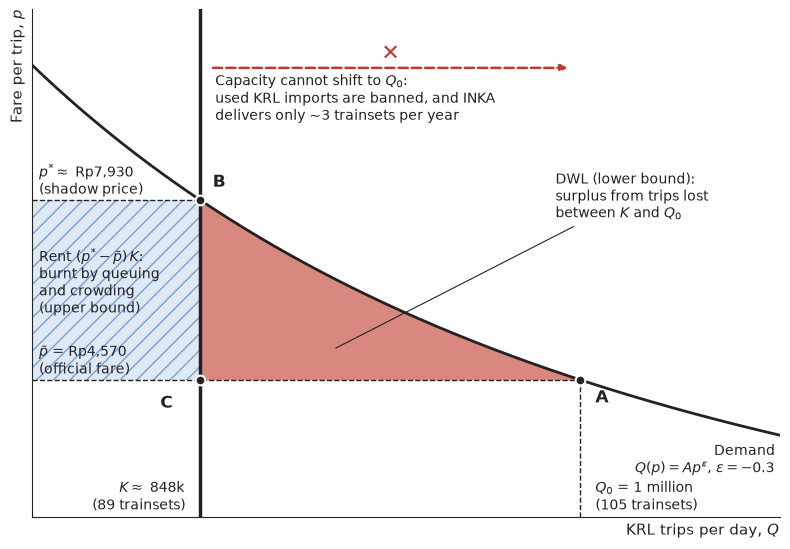

I just watched [this episode of Tempo's Jelasin Dong](https://www.youtube.com/watch?v=7Kgv8JXxyGE) on KRL (Jakarta's commuter rail), INKA, and KAI. It is fairly comprehensive: the KRL fleet shortage, INKA's slow production and piling debt, all the way to the planned KAI–INKA merger. To me, it is a perfect case for talking about one of our government's favourite industrial policy instruments: **TKDN**, a.k.a. _local content requirement_ (LCR).

I once [built a simple TKDN model](). The conclusion: TKDN is not free, its cost just doesn't show up in the state budget (APBN). The KRL case is nice to dissect because the cost can (roughly) be calculated, and we can see who pays.

Spoiler: the ones paying are the _anker_, short for _anak kereta_, Jakarta slang for KRL commuters.

## TKDN in the INKA case

In Indonesia, the only **domestic** producer of rolling stock is INKA (a state-owned enterprise). So in the domestic market INKA is a monopoly, and its only competition is imports. Its main buyers are KAI and its subsidiary, KAI Commuter (KCI), which operates the KRL. For years KCI has filled its fleet needs with **used KRL trains from Japan**, which are cheap and arrive quickly.

In 2023, however, that import route was closed. KCI applied to import 348 used E217-series cars. The Ministry of Industry [refused to issue a technical recommendation](https://www.cnnindonesia.com/ekonomi/20230302082911-92-919704/alasan-kemenperin-tolak-beri-rekomendasi-izin-impor-krl-bekas-jepang) because these non-new capital goods did not meet TKDN requirements and were not in line with the program to Increase the Use of Domestic Products (P3DN). BPKP (the state audit and development agency) then reviewed the case and [also did not recommend the import](https://www.liputan6.com/bisnis/read/5253748/tok-impor-krl-bekas-jepang-resmi-ditolak). BPKP's reasons were not only about domestic production: [the handling and shipping costs proposed by KCI were deemed unreliable](https://www.suara.com/bisnis/2023/04/06/124026/bpkp-temukan-kejanggalan-biaya-impor-krl-bekas), and [the existing fleet (1,114 cars) was judged still sufficient](https://nasional.kontan.co.id/news/hasil-review-bpkp-impor-krl-bekas-tak-direkomendasikan) because 2023 ridership was still far below 2019. So TKDN/P3DN is part of the policy context, not the only reason. The remaining options were to retrofit old KRL cars at INKA and wait for new KRL trains built by INKA ([chronology here](https://id.wikipedia.org/wiki/Polemik_impor_KRL_bekas_tahun_2023)). In the end KCI ordered 16 new trainsets plus retrofits from INKA. Later on, KCI was also allowed to import **new** KRL trains from [CRRC (China)](https://www.tempo.co/ekonomi/kai-klaim-92-persen-pengadaan-krl-bekerja-sama-dengan-inka-total-investasi-rp6-06-triliun-89355).

So the rules of the game are roughly: **buy from INKA. If you must import, it has to be new, used is not allowed.**

What is the goal? This is never clear. Growing INKA? Measured by what: assets, output, employment, profit, or _know-how_? If the goal really is to grow INKA, the government could have chosen a **subsidy**. The difference is that a subsidy needs the APBN and shows up in the Budget Financial Note, so it has to be accounted for before parliament (DPR). TKDN appears to need no APBN at all. Free.

But is it really free?

## Who bears the cost?

The first to be hit are of course KAI/KCI as buyers. They have to buy goods that are more expensive per year of use (calculated below) and arrive more slowly. But KCI cannot simply pass this cost on through prices, because **KRL fares are regulated by the government** and subsidised through a PSO (public service obligation). The fare is still Rp3,000 for the first 25 km plus Rp1,000 per additional 10 km, and even the [plan for NIK-based (ID-based) fares](https://finance.detik.com/berita-ekonomi-bisnis/d-7513056/subsidi-krl-berbasis-nik-di-2025-tarifnya-bakal-naik) has not gone ahead.

If prices cannot rise, the adjustment happens through **quantity**. According to the video:

- KRL Jabodetabek (Greater Jakarta) carries more than **1 million passengers per day**: January–August 2026 saw 277.3 million passengers, or about 1.14 million per day on average ([KAI](https://www.kai.id/publikasi/siaran-pers/6-trainset-krl-ie305-kembali-beroperasi-kai-dan-inka-tuntaskan-perawatan-satu-trainset-terakhir)). According to the video, the number of trips is usually around 1,065 per day, and it dropped to 1,048 in September 2026, coinciding with the withdrawal of 7 INKA-built trainsets for maintenance ([KAI](https://www.kai.id/publikasi/siaran-pers/6-trainset-krl-ie305-kembali-beroperasi-kai-dan-inka-tuntaskan-perawatan-satu-trainset-terakhir)).
- Normal operations require around **105 trainsets**, but only around **89** are running.
- INKA targets 8 trainsets per year, but actually delivers around **3 per year**. Of the 16 trainsets ordered, only 4 were in operation as of January 2026 ([Investortrust](https://investortrust.id/business/92535/kai-commuter-pastikan-12-trainset-inka-tiba-juni-2026-operasi-mulai-juli)). As of early October 2026, 7 INKA-built trainsets (iE305 series) had entered service, but all seven had to be withdrawn for maintenance. 6 are back in service and 1 is still being completed together with INKA ([KAI](https://www.kai.id/publikasi/siaran-pers/6-trainset-krl-ie305-kembali-beroperasi-kai-dan-inka-tuntaskan-perawatan-satu-trainset-terakhir)).

But didn't BPKP say the fleet was sufficient? That was a 2023 assessment, when ridership had not yet recovered from the pandemic. The benchmark then was 2019, when 1,078 cars carried 336.3 million passengers ([Kontan](https://nasional.kontan.co.id/news/hasil-review-bpkp-impor-krl-bekas-tak-direkomendasikan)). Ridership is now well past that: 1.14 million per day annualises to about 416 million passengers. So the "fleet is sufficient" assessment no longer holds.

Sure, it doesn't seem to use the APBN, but the cost shows up as too few trains, cut schedules, and ever more crowded carriages. This cost is not recorded in the APBN, but it is still borne by passengers.

## Calculation 1: how much does KAI pay?

Table 1 shows the price per trainset for each procurement option, in billions of Rupiah, along with the assumed service life. The INKA and retrofit prices are computed from KCI's contract values: 16 new trainsets worth Rp3.83 trillion and 19 retrofitted trainsets worth Rp2.23 trillion ([Tempo](https://www.tempo.co/ekonomi/kai-klaim-92-persen-pengadaan-krl-bekerja-sama-dengan-inka-total-investasi-rp6-06-triliun-89355)). The per-trainset figures from this division match those mentioned in Jelasin Dong (around minute 17:45). The price of used Japanese KRL is taken from the Jelasin Dong video. This figure is in line with KAI's 2023 budget of Rp150 billion for 10 used trainsets ([Wikipedia](https://id.wikipedia.org/wiki/Polemik_impor_KRL_bekas_tahun_2023)). The CRRC price is Rp783 billion divided by 3 trainsets.

| Option | Price per trainset (Rp bn) | Assumed service life (years) |
|---|---:|---:|
| Used Japanese KRL | 19.2 | 10 |
| Retrofit at INKA | 117.6 | 15 |
| New INKA KRL | 239.3 | 30 |
| New CRRC KRL | 261.0 | 30 |

One thing is interesting: **new INKA trains are actually not more expensive than CRRC's**. So the problem is not "INKA is more expensive than new imports". The problem lies in two things: (1) the ban on **used** imports, and (2) INKA's **slow** delivery.

Of course it is not fair to compare the price of a used train directly with a new one, since used trains depreciate faster and therefore need replacing sooner. To compare apples to apples, we compute the cost per year of use, or _equivalent annual cost_ (EAC):

$$
EAC = P \cdot \frac{r}{1-(1+r)^{-T}}
$$

where $P$ is the purchase price per trainset, $T$ is the service life in years, and $r$ is the discount rate. I use $r$ = 7%, roughly the yield on government bonds (SBN). The service life assumptions in Table 1 are deliberately set against the used option: I give the E217, built in 1994–1999, only 10 years of remaining life, even though used Japanese KRL in Jabodetabek are usually kept in service longer.


```python
def eac(P, T, r=0.07):
    return P * r / (1 - (1 + r) ** -T)

options = {"Used Japanese KRL": (19.2, 10), "Retrofit INKA": (117.6, 15),
           "New INKA KRL": (239.3, 30), "New CRRC KRL": (261.0, 30)}
for k, (P, T) in options.items():
    print(f"{k:18s} EAC = {eac(P, T):6.2f} bn/year")
```

    Used Japanese KRL  EAC =   2.73 bn/year
    Retrofit INKA      EAC =  12.91 bn/year
    New INKA KRL       EAC =  19.28 bn/year
    New CRRC KRL       EAC =  21.03 bn/year
    

Assuming service lives of 10 vs 30 years and equal capacity per trainset, used KRL are **about 7 times cheaper** per year of use than new INKA trains. Retrofits, touted as the "domestic" solution, are almost 5 times more expensive per year than used trains.

Now apply this to the fleet shortfall of 105 − 89 = 16 trainsets. Coincidentally, that is exactly the size of KCI's order from INKA:

- **Upfront spending:** 16 × Rp239.3 bn ≈ **Rp3.83 tn** from INKA, versus 16 × Rp19.2 bn ≈ **Rp0.31 tn** if used. The difference is about **Rp3.5 tn**.
- **Per year of use:** the difference is about **Rp265 billion per year**. If the remaining life of used trains is 15 years, the gap is actually slightly bigger, about Rp275 billion per year.

A few caveats, to be fair. Used trains usually need extra spending before they can be put into service (e.g. replacing the air conditioning), and their maintenance can be more expensive. Spare parts can also be a problem. KAI itself says price is not the only consideration: there is remaining life, technology, spare part availability, maintenance, and energy consumption. The EAC calculation above also **does not yet include** maintenance, energy, import preparation or retrofit costs, residual value, or differences in capacity and reliability. So the "7 times" figure depends on assumptions, it is not a precise number. But with a gap that large, those additional costs would have to be extraordinarily expensive to close it.

So where does the Rp3.83 tn come from? Partly from **PMN** (state capital injections): Rp2 tn in 2024 and Rp1.8 tn in 2025, plus a planned further Rp1.5 tn at the end of 2026 that is still a projection ([Investortrust](https://investortrust.id/business/92535/kai-commuter-pastikan-12-trainset-inka-tiba-juni-2026-operasi-mulai-juli)). But careful, this is **not** evidence that TKDN eats the APBN. Suppose KCI would need trains and get PMN anyway, whether it buys from INKA or used from Japan. Under that assumption, the source of funds is irrelevant. What matters is the **additional** cost caused by the TKDN rule, and that depends on how PMN responds:

1. **PMN stays fixed.** With the same money, a higher price per year of use means fewer trains bought. The whole cost falls on passengers, and this is what the next section calculates.
2. **PMN grows to cover INKA's price.** The spending gap (about Rp3.5 tn upfront, or Rp265 billion per year of use) is effectively an **APBN subsidy to INKA channelled through KAI**. The cost is borne by taxpayers just like a direct subsidy, but it is not recorded as a subsidy to INKA and is not tied to any INKA performance target. Worse than a direct subsidy, because it is not transparent.

Reality is probably a mix of the two. And what about INKA itself, whose [debt is around **Rp4.7 tn**](https://www.kabarbursa.com/makro/besok-danantara-mulai-lagi-lrt-city-inka-terbelit-utang-rp47-triliun) and which will be restructured and recapitalised through Danantara as part of the [merger with KAI](https://jatim.antaranews.com/berita/1102836/dony-oskaria-sebut-merger-inka-dan-kai-rampung-sebelum-januari-2027), targeted for completion before January 2027? This injection does not go through the APBN, so it is not a direct state subsidy. But it is another trick to prop up INKA without the APBN, similar to what happened with the construction SOEs (BUMN Karya), and just as bad in terms of transparency. In this post, "doesn't need the APBN" means a direct state subsidy. So I don't count the Danantara injection as a cost of TKDN, even though it shows that this supposedly free policy did not even manage to make INKA healthy.

## Calculation 2: how much do passengers pay?

This is the part most often forgotten. Because fares are fixed, the train shortage does not show up as a price increase, but as **rationing**: some people don't get a decent service, the rest are crammed in.

The approach is similar to my [JORR post](): take a demand curve and compute the lost consumer surplus. Compared to that post, though, I add two improvements. First, the areas are computed with an integral rather than approximated by a triangle (thanks AI). Second, I give a **lower and an upper bound**, because how passengers "pay" for rationing determines how big the cost is.

The demand curve for KRL trips is assumed to have constant elasticity:

$$
Q(p) = A p^{\varepsilon}
$$

where $Q$ is the number of trips per day, $p$ is the fare per trip, $\varepsilon < 0$ is the price elasticity of demand, and $A$ is a scale constant. Public transport demand is usually inelastic. The short-run rule of thumb in the literature is around −0.3, with a range of −0.2 to −0.5[^1]. This is a rule of thumb for public transport in general, not an estimate for KRL, and long-run elasticities are usually larger. I couldn't find a credible estimate of KRL elasticity, so I use this range.

The results in this section are **illustrative scenarios**, not estimates measured from data. The assumptions:

- Average fare $\bar{p}$ = Rp4,570 per trip. This is KCI's 2023 ticket revenue (Rp1.52 tn) divided by 331.9 million passengers ([KCI Annual Report 2023](https://kci.id/files/download/annual_report/FAAR_2023.pdf)), and it is consistent with an average trip length of around 36 km. Both figures cover all KCI services, not just Jabodetabek, but Jabodetabek accounts for 88% of passengers (290.9 of 331.9 million) with a similar fare scheme.
- At fare $\bar{p}$, demand $Q_0$ = 1 million trips per day (a round number, slightly below 2026 actuals), and 105 trainsets is the fleet needed to serve it at a normal standard.
- With 89 trainsets, standard service capacity is only $K = \frac{89}{105} Q_0 \approx 848$ thousand trips per day.
- Capacity is assumed proportional to the number of trainsets, and all trips are assumed equivalent. These two assumptions, not just the elasticity, are what make the range of results wide.

At fare $\bar{p}$, people want to make $Q_0$ trips, but capacity is only $K$. The shadow price $p^{*}$ is the fare at which demand exactly equals capacity:

$$
p^{*} = \bar{p}\left(\frac{K}{Q_0}\right)^{1/\varepsilon}
$$

With $\varepsilon = -0.3$, we get $p^{*} \approx$ Rp7,900. That is, at the margin there are passengers who would actually be willing to pay almost twice the official fare, yet still can't get a decent service.

**Lower bound: _deadweight loss_.** If the seats go to the people who need them most (efficient rationing), the loss is only the surplus from the trips that are lost:

$$
DWL = \int_{K}^{Q_0} \left[P(q) - \bar{p}\right] dq
$$

where $P(q) = \bar{p}\,(q/Q_0)^{1/\varepsilon}$ is the inverse demand curve.

**Upper bound (hypothetical): dissipated rent.** In the real world, KRL is not rationed to those who need it most. It is rationed by who is strong enough to stand and push, who arrives earliest, and who is willing to wait for the next train. Barzel (1974)[^2] shows that when rationing is done through queuing or time, the gap $(p^{*} - \bar{p})$ for every trip served can, **at most**, be entirely "paid" in lost time and comfort. The literature also shows that non-price rationing allocates goods to the wrong people (_misallocation_)[^3], and that crowding on trains has a real monetary value to passengers[^4], although there is no calibration for KRL Jabodetabek yet. So the upper bound, deliberately extreme because it assumes the entire rent is dissipated on every trip, is:

$$
L^{upper} = DWL + (p^{*} - \bar{p})\,K
$$

Figure 1 illustrates the upper and lower bounds of the loss borne by consumers. The horizontal axis is the number of KRL trips per day $Q$, the vertical axis is the fare per trip $p$ in Rupiah. The black curve is demand $Q(p)$ with $\varepsilon = -0.3$, calibrated from the assumptions above (an average fare of Rp4,570 at 1 million trips per day). The thick vertical line is capacity $K$ with 89 trainsets. The axes do not start at 0 so that the areas are visible.


```python
import numpy as np
import matplotlib.pyplot as plt

eps, p, Q0, x = -0.3, 4570, 1e6, 89 / 105
K = x * Q0
pstar = p * x ** (1 / eps)
P = lambda q: p * (q / Q0) ** (1 / eps)          # inverse demand curve

ink, red, blue = "#222222", "#c0392b", "#2c6fbb"
qlo, qhi, plo, phi = 0.78 * Q0, 1.08 * Q0, 2000, 11500
q = np.linspace(qlo, qhi, 400)

fig, ax = plt.subplots(figsize=(8, 5.6))
ax.plot(q / 1e3, P(q), color=ink, lw=2)

qd = np.linspace(K, Q0, 200)
ax.fill_between(qd / 1e3, p, P(qd), color=red, alpha=0.6, lw=0)
ax.fill_between([qlo / 1e3, K / 1e3], p, pstar, color=blue, alpha=0.15, lw=0)
ax.fill_between([qlo / 1e3, K / 1e3], p, pstar, facecolor="none", edgecolor=blue,
                hatch="//", lw=0, alpha=0.6)

ax.axvline(K / 1e3, color=ink, lw=2.5)
ax.plot([Q0 / 1e3, Q0 / 1e3], [plo, p], color=ink, lw=1, ls="--")
ax.plot([qlo / 1e3, Q0 / 1e3], [p, p], color=ink, lw=1, ls="--")
ax.plot([qlo / 1e3, K / 1e3], [pstar, pstar], color=ink, lw=1, ls="--")

for X, Y, lab, dx, dy in [(Q0, p, "A", 6, -420), (K, pstar, "B", 5, 250), (K, p, "C", -16, -520)]:
    ax.plot(X / 1e3, Y, "o", color=ink, ms=7, mec="white", mew=1.5)
    ax.text(X / 1e3 + dx, Y + dy, lab, fontsize=12, fontweight="bold", color=ink)

fs = 10
ax.text(qlo / 1e3 + 3, p + 120, r"$\bar{p}$ = Rp4,570" "\n(official fare)", fontsize=fs, color=ink)
ax.text(qlo / 1e3 + 3, pstar + 120, r"$p^{*}\approx$ Rp7,930" "\n(shadow price)", fontsize=fs, color=ink)
ax.text(K / 1e3 - 6, plo + 150, r"$K\approx$ 848k" "\n(89 trainsets)", fontsize=fs, color=ink, ha="right")
ax.text(Q0 / 1e3 + 6, plo + 150, r"$Q_0$ = 1 million" "\n(105 trainsets)", fontsize=fs, color=ink, ha="left")
ax.text(qhi / 1e3 - 2, 3400, "Demand\n" r"$Q(p)=Ap^{\varepsilon}$, $\varepsilon=-0.3$",
        fontsize=fs, color=ink, ha="right", va="top")

ax.annotate("DWL (lower bound):\nsurplus from trips lost\nbetween $K$ and $Q_0$",
            xy=((K + 0.35 * (Q0 - K)) / 1e3, p + 0.3 * (P(K + 0.35 * (Q0 - K)) - p)),
            xytext=(0.99 * Q0 / 1e3, 7600), fontsize=fs, color=ink, ha="left",
            arrowprops=dict(arrowstyle="-", color=ink, lw=0.8))
ax.text(qlo / 1e3 + 3, (p + pstar) / 2 + 150,
        r"Rent $(p^{*}-\bar{p})\,K$:" "\nburnt by queuing\nand crowding\n(upper bound)",
        fontsize=fs, color=ink, va="center")

ax.annotate("", xy=(Q0 / 1e3 - 4, 10400), xytext=(K / 1e3 + 4, 10400),
            arrowprops=dict(arrowstyle="-|>", color=red, lw=1.8, ls="--"))
ax.text((K + Q0) / 2 / 1e3, 10450, "✕", fontsize=16, color=red, ha="center", va="bottom",
        fontweight="bold")
ax.text(K / 1e3 + 6, 10300, "Capacity cannot shift to $Q_0$:\n"
        "used KRL imports are banned, and INKA\ndelivers only ~3 trainsets per year",
        fontsize=fs, color=ink, ha="left", va="top")

ax.set_xlim(qlo / 1e3, qhi / 1e3)
ax.set_ylim(plo, phi)
ax.set_xticks([]); ax.set_yticks([])
ax.grid(False)
for s in ("top", "right"):
    ax.spines[s].set_visible(False)
for s in ("left", "bottom"):
    ax.spines[s].set_color(ink)
ax.set_xlabel("KRL trips per day, $Q$", fontsize=11, color=ink, loc="right")
ax.set_ylabel("Fare per trip, $p$", fontsize=11, color=ink, loc="top")
fig.tight_layout()
plt.show()

```


    

    


Point A is what the market "demands" at the official fare: at fare $\bar{p}$, people want to make $Q_0$ = 1 million trips per day, which requires 105 trainsets. Point B is the price that equates demand with existing capacity: if the fare could move freely, it would rise to $p^{*} \approx$ Rp7,930 and the excess demand would disappear. What happens in the real world is point C: the fare stays at $\bar{p}$ because it is regulated by the state, but standard service is only $K$, leaving excess demand of $Q_0 - K \approx$ 152 thousand trips per day.

In a normal market, excess demand like this is met through quantity: the capacity line shifts right towards $Q_0$. Here quantity cannot adjust because of two things at once. Used KRL imports are banned, and INKA cannot deliver trainsets as fast as needed (3 out of a target of 8 per year). So the capacity line is stuck at 89 trainsets, the price is stuck at $\bar{p}$, and the adjustment is forced through rationing.

The red triangle is the classic $DWL$ from intro microeconomics: the surplus from trips between $K$ and $Q_0$ that simply vanishes and goes to no one. This is the lower bound. The hatched blue rectangle is the rent $(p^{*}-\bar{p})\,K$: surplus that should go to the passengers who are still served, but under rationing by queuing and crowding can be entirely burnt. The upper bound $L^{upper}$ is the sum of the two. The code below computes both areas for three elasticity values.


```python
def cost(eps, p=4570, Q0=1e6, x=89/105):
    K = x * Q0
    pstar = p * x ** (1 / eps)
    a = 1 + 1 / eps
    integral = p * Q0 * (1 - x ** a) / a      # ∫_K^Q0 P(q) dq
    dwl = integral - p * (Q0 - K)
    rent = (pstar - p) * K
    return pstar, dwl * 365 / 1e9, (dwl + rent) * 365 / 1e9

for e in (-0.2, -0.3, -0.5):
    ps, lower, upper = cost(e)
    print(f"eps={e}: p*=Rp{ps:,.0f}  lower=Rp{lower:,.0f} bn/yr  upper=Rp{upper:,.0f} bn/yr")
```

    eps=-0.2: p*=Rp10,445  lower=Rp137 bn/yr  upper=Rp1,954 bn/yr
    eps=-0.3: p*=Rp7,930  lower=Rp82 bn/yr  upper=Rp1,122 bn/yr
    eps=-0.5: p*=Rp6,361  lower=Rp46 bn/yr  upper=Rp600 bn/yr
    

In this scenario, the 16-trainset shortfall costs passengers roughly **Rp46 billion to Rp2 trillion per year**, with the middle scenario (ε = −0.3) at **Rp82 billion to Rp1.1 trillion per year**. The range is wide, and it has to be wide because there are many assumptions. Remember, this is a model result built on unverified assumptions, not a measured bill to passengers. The only thing we can say with reasonable confidence is the direction: anyone who has taken the KRL from Bogor at 7 a.m. knows the rationing is clearly not efficient, so the true figure is likely above the lower bound.

How long has this shortage lasted? The used import was rejected in early 2023. Used KRL could arrive within months, whereas INKA's orders only started arriving in 2025–2026 and some are still late. Call it roughly 3 years, assuming the shortage and its cost stay constant over that period. The total is then about **Rp0.25 tn to Rp3.4 tn** for the middle scenario. This cost shows up as more crowded and more limited service. Who ultimately bears the fiscal cost depends on how KAI/KCI are funded, as in the two PMN cases above.

Compare this with KAI's spending gap above, about Rp265 billion per year. At the lower bound, the cost on the passenger side is indeed smaller than that. But at the upper bound, the passenger-side cost could be around 4 times the buyer-side cost. This ratio is only illustrative, since it compares passengers' welfare loss with a difference in purchase prices, two quantities of a different kind. The point is not the ratio itself, but that the passenger-side cost **can** be as large as or larger than the buyer-side cost. This is what my old TKDN model did not capture. In that model quantity was fixed and the cost was only the producer's margin. In the real world, a binding TKDN and a slow supplier also cut **quantity**.

## So, is it worth it?

A few key points:

1. **TKDN is not free.** It doesn't show up as a subsidy line in the APBN, but its cost moves to the buyer (KAI/KCI) and ultimately to passengers through worse service. If PMN to KCI grows to cover INKA's price, part of that cost is in fact a disguised APBN subsidy to INKA. Add the Danantara injection outside the APBN, and support for INKA is spread across many pockets, making the total hard to count.
2. **The cost is not shared evenly.** If INKA were subsidised through the APBN, the cost of industrialisation would be borne by all taxpayers. Through TKDN, the cost is concentrated on roughly a million KRL passengers a day, most of whom ride the train to **get to work**. The time and energy spent on platforms and in crowded carriages is productivity lost in offices, factories, and shops across Jabodetabek. So we are taxing the most productive economic activity in the country for the sake of one factory in Madiun.
3. **It can be worth it, under conditions.** The _infant industry_ literature shows that protection **can** raise welfare if there is learning the market cannot capture on its own and the industry actually becomes efficient, and the choice of instrument matters too[^5]. The newer industrial policy literature also stresses discipline, clear measures of success, and readiness to end programs that fail[^6]. So the question is: is the "surplus" transferred from commuters to INKA actually used to build production capacity and _know-how_? If INKA still produces 3 trainsets a year against a target of 8, delivers late, and carries Rp4.7 tn in debt, there is no evidence of that so far. And for how long? Meanwhile, commuters might be more productive in other sectors, sectors that happen to be held back by transport.

A disclaimer first: while I'm confident about the economics, I am not a railway expert and literally only started digging into trains after watching that Jelasin Dong video. The calculations in this post are very rough and not reliable, so they should be interpreted with care. Rough as they are, though, the logic of the calculation may still be useful. The code is above, and hopefully it can be a starting point for building a better-suited model with better-calibrated numbers.

Even if our calculations are far from perfect, **the calculation still has to be done**. No policy is free. Every government intervention has a cost. The only difference is who pays and how they pay. Policymakers who ignore this and think TKDN is free are putting their economic illiteracy on display.

That's it for now. Mention me on [twitter](https://www.twitter.com/imedkrisna) if you have comments, criticism, or suggestions. Thank youu.

[^1]: Litman, T. (2004). Transit Price Elasticities and Cross-Elasticities. *Journal of Public Transportation*, 7(2), 37–58. https://doi.org/10.5038/2375-0901.7.2.3
[^2]: Barzel, Y. (1974). A Theory of Rationing by Waiting. *The Journal of Law and Economics*, 17(1), 73–95. https://doi.org/10.1086/466785
[^3]: Glaeser, E. L., & Luttmer, E. F. P. (2003). The Misallocation of Housing Under Rent Control. *American Economic Review*, 93(4), 1027–1046. https://doi.org/10.1257/000282803769206197
[^4]: Wardman, M., & Whelan, G. (2011). Twenty Years of Rail Crowding Valuation: Methods, Evidence and Lessons from British Experience. *Transport Reviews*, 31(3), 379–398. https://doi.org/10.1080/01441647.2010.519127
[^5]: Melitz, M. J. (2005). When and How Should Infant Industries Be Protected? *Journal of International Economics*, 66(1), 177–196. https://doi.org/10.1016/j.jinteco.2004.07.001
[^6]: Juhász, R., Lane, N., & Rodrik, D. (2024). The New Economics of Industrial Policy. *Annual Review of Economics*, 16, 213–242. https://doi.org/10.1146/annurev-economics-081023-024638
