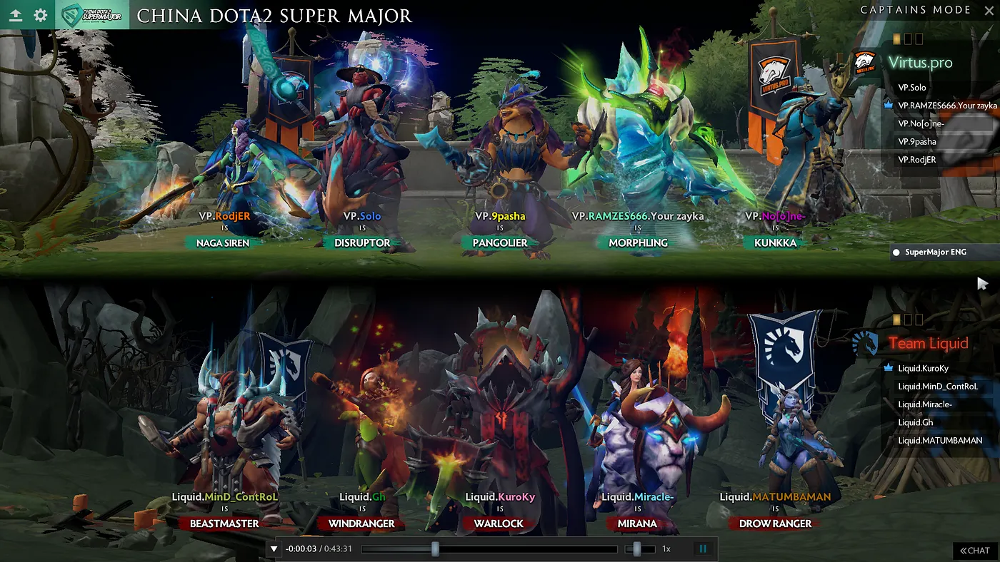
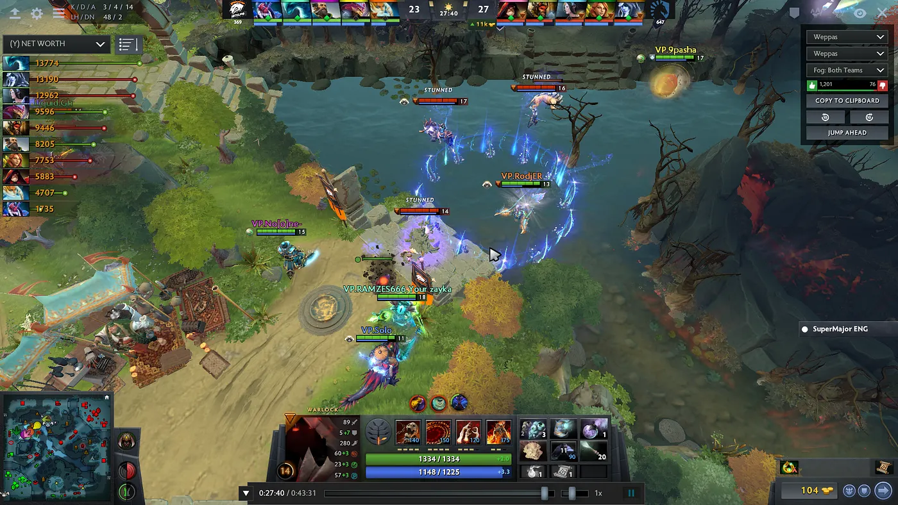
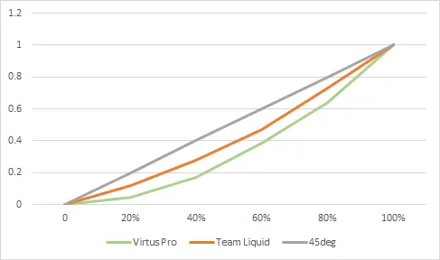

_Tulisan ini pertama kali terbit di [Medium](https://medium.com/@imedkrisna/ketika-ketimpangan-adalah-strategi-sebuah-pelajaran-dari-dota-f68aef696b37)._

Saya adalah seorang _gamer_. Dulu saya hobi sekali bermain _video game_, terutama genre RPG. Sekarang aktivitas bermain game sudah jauh berkurang, tetapi saya masih kadang-kadang menonton turnamen game. Suatu hari saya menonton turnamen dari salah satu game favorit saya, _Defense of the Ancients_ atau DotA. Game ini cukup terkenal di kalangan penggemar MOBA, tetapi mungkin asing bagi sebagian besar orang awam. Sebagai gambaran, turnamen DotA terbesar tahun 2017, The International 7, punya total hadiah sekitar 24 juta dolar AS. Hadiah ini diperebutkan oleh 18 tim, atau 90 orang pemain. Kalau dibagi rata ke 90 orang, setiap orang mendapat sekitar 260 ribu dolar AS. Pemenang Super Bowl saja hanya mendapat 107 ribu. Wuiiih….

Turnamen yang saya tonton waktu itu namanya "China Dota2 Super Major", pertandingan Grand Final, _Best of 5_: tim yang menang 3 kali lebih dulu menjadi juara. Pertandingannya Team Liquid melawan Virtus Pro.

Karena pertandingannya tampak seru, istri saya ikut menonton. Ia mulai bertanya-tanya soal DotA, pertanyaan pemula pada umumnya. Pada satu saat ia bertanya ketika layar menampilkan _net worth_. Saya jelaskan apa itu _net worth_, lalu ia menimpali, "Loh, _net worth_-nya kok timpang banget?"

## Sekilas tentang DotA dan _net worth_

DotA adalah pionir game bergenre MOBA. Game lain yang masuk kategori ini antara lain Arena of Valor dan Mobile Legends. Game ini dimainkan daring dan _multiplayer_, dengan 10 pemain per ronde yang terbagi ke dalam 2 tim. Masing-masing tim berusaha melindungi bangunan bernama _ancient_ yang berada di markas masing-masing. Tim yang menang adalah tim yang lebih dulu menghancurkan _ancient_ lawan.

Yang membedakan MOBA dari game tembak-tembakan seperti Counter-Strike adalah sistem _leveling_. Di DotA, Anda mengontrol 1 karakter _hero_ yang dimulai dari level 1. Hero ini naik level dengan membunuh _creep_ yang dikontrol komputer, atau membunuh hero lawan. _Creep_ muncul setiap selang waktu tertentu dari arah markas kedua kubu. Setiap kali membunuh _creep_, kita mendapat _gold_ dan _experience_. _Gold_ dapat dipakai untuk membeli _item_.

Dengan menumpuk _gold_, kita menumpuk _net worth_. Meskipun tujuan akhirnya adalah menghancurkan _ancient_ musuh, mengumpulkan _gold_ sangat penting karena _gold_ dapat dipakai untuk membeli barang yang meningkatkan kekuatan kita. Tim yang duitnya lebih banyak akan punya keunggulan dibandingkan tim yang kere.

Jadi, 5 lawan 5, terbagi ke 3 jalur berbeda.

Gambar 2 kira-kira menunjukkan tampilan DotA. Tim berlabel merah adalah Team Liquid, sedangkan yang hijau adalah Virtus Pro. _Net worth_ ditampilkan di pojok kiri atas.

Kira-kira percakapan awal saya dengan istri saya begini:

> **Istri (I):** "Itu apa? (sambil menunjuk kiri atas)"
>
> **Saya (S):** "Oh, itu namanya _net worth_. Kekayaan masing-masing pemain."
>
> **I:** "Gimana ngitungnya?"
>
> **S:** "Kira-kira jumlah _gold_-nya (kanan bawah) ditambah harga _item_ yang dipegang hero tersebut. Lihat di tengah bawah, agak ke kanan sedikit. Ada 6 kotak besar dan 3 kotak kecil."
>
> **I:** "Oh. Jomplang ya."

DotA selalu dimulai dengan hero level 1 dan _gold_ sekitar 600. Semua karakter punya _gold_ yang sama di awal permainan. Lalu kenapa di akhir permainan bisa berbeda jauh? Pada Gambar 2, hero terkaya punya _net worth_ 13.774, sementara pemain termiskin hanya 1.735!! Sedih yha.

## Mengukur ketimpangan di DotA

Salah satu ukuran ketimpangan adalah koefisien Gini dan kurva Lorenz. Koefisien Gini berupa angka antara 0 dan 1, dengan 1 berarti sangat timpang dan 0 berarti sangat merata. Kurva Lorenz menampilkan ketimpangan secara visual dalam bentuk grafik: makin dekat ke garis 45 derajat, makin merata distribusinya. Kurva Lorenz kedua tim dapat dilihat pada Gambar 3.

Jika dihitung, Team Liquid punya koefisien Gini sebesar 0,16, sementara Virtus Pro 0,305. Dibandingkan dengan dunia nyata, koefisien Gini Virtus Pro setingkat dengan Austria dan Pakistan. Gini Team Liquid tidak ada tandingannya: estimasi Bank Dunia menyebut Gini terendah adalah Ukraina, yaitu 0,25 pada tahun 2015. (Catatan: angka dunia nyata menggunakan ketimpangan pendapatan. Mungkin kurang pas, seharusnya ketimpangan kekayaan, tetapi data ketimpangan kekayaan lebih sulit dicari.)

Di dunia nyata, sulit menerka apa penyebab ketimpangan dan bagaimana melawannya. Namun di DotA, ketimpangan memang harus terjadi _by design_. Bahkan, ketimpangan adalah strategi menuju kemenangan. Tim yang baik justru harus timpang. Lho, kok bisa?

## Tidak semua hero diciptakan sama

Seperti dibahas sebelumnya, di DotA hero mengumpulkan kekayaan dengan membunuh _creep_. Istilahnya, _farming_. Masalahnya, jumlah _creep_ terbatas. Ada 2 jenis _creep_: _lane creep_ dan _creep_ hutan. _Lane creep_ muncul setiap 30 detik, sementara _creep_ hutan setiap 1 menit. Daripada dibagi rata (semua hero membunuh jumlah _creep_ yang sama), keterbatasan ini memaksa hero untuk berspesialisasi: biarkan 1 jagoan mendapatkan sebagian besar _creep_.

Di DotA 2, dari 5 hero dalam satu tim, ada yang berperan sebagai _carry_, yaitu jagoan yang akan membawa tim menuju kemenangan, dan ada yang berperan sebagai _support_. Biasanya di _lane_, hero _carry_ diusahakan mendapat uang sebanyak mungkin. Tugas _support_ adalah memastikan _carry_ timnya kaya, dan membuat _carry_ musuh semiskin mungkin.

Dalam pertandingan ini, ketimpangan Team Liquid, tim yang keluar sebagai pemenang, memang lebih kecil daripada Virtus Pro. Tetapi itu lebih karena Team Liquid secara umum memang lebih kaya. GDP Liquid di akhir permainan sebesar 49 ribu, sementara Virtus hanya 38 ribu. Team Liquid berhasil membatasi kemampuan _farming_ Virtus Pro, sehingga Virtus Pro memusatkan _farm_-nya pada 1 hero (yha maklum, kalau qismin, pilihan makin terbatas). Namun secara umum, taktik di DotA sama: buat 1–2 hero sekaya mungkin. Hasilnya? Ketimpangan!

Di DotA, ada hero yang cocok menjadi _carry_ dan ada yang cocok menjadi _support_. Hero _carry_ biasanya agak lemah di awal permainan dan mengandalkan _damage_ dari serangan biasa. Sebaliknya, hero _support_ punya kemampuan yang lebih ke pemulihan (_heal_) atau utilitas (_stun_, _hex_). Lebih baik hero _carry_ yang kaya, karena di akhir permainan dibutuhkan _damage_ yang berkelanjutan. Istilahnya, kalau semua bisa kaya tentu lebih baik, tetapi lebih efisien memberikan kekayaan ke hero _carry_.

Jadi intinya, ini adalah masalah distribusi sumber daya. Berikan sebagian besar sumber daya kepada yang paling berpotensi memenangkan tim Anda!

DotA tidak selalu seperti ini. Waktu saya mulai bermain DotA (masih DotA 1, _mod_ dari Warcraft III), kami bermain sembarangan. Dulu kami bermain _all random_, di mana hero setiap pemain dipilihkan komputer secara acak. Semua mengumpulkan duit, bunuh ya bunuh saja. Bahkan ketika kami mulai bermain _all pick_, di mana hero dipilih sendiri, kami belum memakai strategi ketimpangan tersebut. Benar-benar _free market_.

Semua berubah ketika IceFrog, sang pencipta DotA, pindah ke Valve dan membuat game sendiri, DotA 2, dengan turnamen kelas dunia. Rasanya di sinilah model _carry-support_ pertama kali diperkenalkan secara terstruktur. Semua tim hebat dunia memakai model ini, dan akhirnya model ini menjadi acuan bagi pemain kasual. Bahkan dalam permainan bersama orang asing, model _carry-support_ menjadi _common knowledge_ alias TST, Tahu Sama Tahu. Ya, di _free market game_, di mana Anda tidak berkoordinasi secara sempurna dengan orang lain, Anda otomatis akan bermain dengan model _carry-support_, karena model ini terbukti sukses di DotA.

(Sedikit _caveat_: sistem DotA sendiri sudah banyak berubah dibanding awal saya bermain. Dulu kita bisa bertukar _item_ dengan teman, misalnya Zeus yang membeli Battle Fury lalu memberikannya ke Sven; sekarang tidak bisa. Dan masih banyak perubahan lainnya.)

## Bagaimana dengan dunia nyata?

Distribusi sumber daya seperti ini juga dilakukan di dunia nyata. Contoh paling mudah adalah pembagian APBN. Ketimpangan alokasi APBN menunjukkan prioritas pemerintah. Untuk tahun 2018, anggaran terbesar ada di Kementerian PUPR. Dengan asumsi bahwa Kementerian PUPR adalah kementerian yang paling banyak membangun infrastruktur, sekitar 10% APBN digunakan untuk infrastruktur. Kita juga tahu bahwa anggaran pendidikan sudah dipatok sebesar 20% APBN. Dua sektor inilah yang dianggap sebagai _carry_ Indonesia saat ini.

Contoh lainnya adalah _picking winners_, yaitu kebijakan industri di mana pemerintah menargetkan sektor tertentu untuk diberikan kemudahan dan subsidi, karena sektor tersebut dianggap paling mungkin meningkatkan PDB, mempercepat kemajuan teknologi, atau menciptakan lapangan kerja paling banyak. Strategi _picking winners_ (dan intervensi pemerintah secara umum) mulai dilirik lagi sejak Krisis Keuangan Global (Stiglitz, Lin & Monga 2013).

Contoh lain? Di tengah keterbatasan dana beasiswa, tentu penerima beasiswa harus bertipe _carry_: pintar, pasti pulang ke Indonesia, dan akan membawa Indonesia ke arah yang lebih baik. Apakah duit beasiswanya boleh dipakai untuk plesir sambil apdet-apdet Instagram? Silakan ikuti perdebatan itu di tempat lain, saya tidak ikut-ikut xD

## Apakah tak-tik ini akan sukses di dunia nyata?

Pertanyaan bagus nech. Coba lihat 3 contoh di atas dan renungkan xD

Namun ada 1 hal fundamental yang membuat kita harus berhati-hati dengan tak-tik _picking winners_ ini, yaitu pandangan jangka panjang. Dalam konteks DotA: kapan permainan berhenti.

DotA adalah game yang cukup sederhana: permainan berakhir saat _ancient_ musuh hancur. Pertanyaannya, apa yang terjadi jika setelah kita menang, permainan tidak berakhir?

## Skenario pasca-perjuangan

Kelima orang yang berhasil mengalahkan musuh ini kemudian mendirikan negara sendiri. Mereka membuat suatu ideologi dan menurunkannya ke anak-cucu. Si _carry_ menurunkan kekayaannya ke anaknya saja (bahkan mungkin anaknya banyak sekali karena istrinya banyak; maklum, _carry_, semua wanita tergila-gila padanya), sementara si _support_, saking qisminnya, membayar listrik saja sulit. Setelah kelima orang ini beranak-pinak, ketimpangan menjadi semakin terlihat. Anak si _carry_ mendirikan partai dan sangat aktif di politik, sementara anak si _support_… ah, sudahlah.

Sedih ya? Untungnya DotA hanya berhenti sampai musuh dikalahkan. Ketika musuh sudah kalah, kita tidak perlu memikirkan apa-apa lagi. Cukup fokus mengalahkan musuh di permainan berikutnya.

Saya akan mengakhiri tulisan ini dengan mengutip kata-kata Bung Karno, sang proklamator:

> Perjuanganku lebih mudah karena mengusir penjajah, tapi perjuanganmu akan lebih sulit karena melawan bangsamu sendiri.
