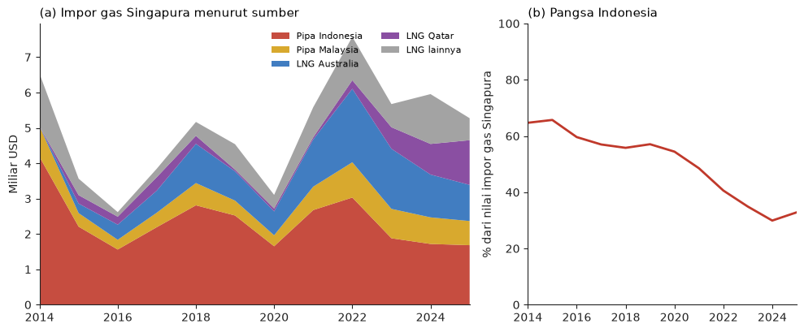
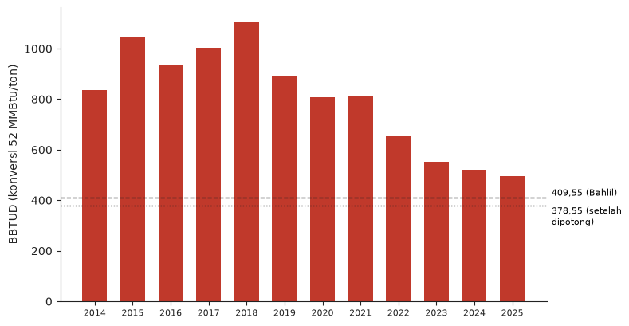
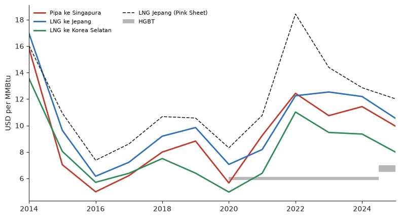
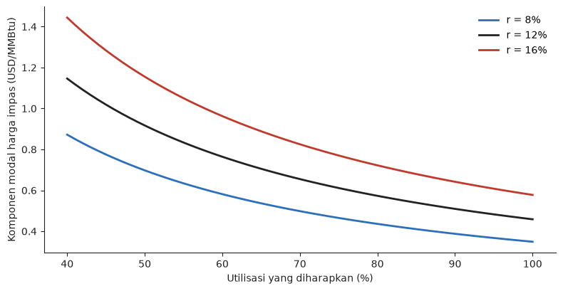

## Pendahuluan

Minggu lalu urusan gas tiba-tiba jadi urusan diplomatik. Kronologinya kira-kira begini:

1. **21 Oktober.** Usai Sidang Kabinet Paripurna, setelah Presiden menyebut Indonesia sedang dalam "mode _survival_", Menteri ESDM Bahlil Lahadalia membuka opsi [tidak memperpanjang kontrak ekspor gas ke negara tetangga](https://rmol.id/read/2026/10/21/725801/mode-survival-bahlil-bisa-setop-ekspor-gas-ke-negara-tetangga). Sehari kemudian nadanya naik: Indonesia "tidak segan-segan" mempertimbangkan untuk tidak mengekspor ke negara yang ["tidak menghargai Indonesia"](https://katadata.co.id/berita/energi/6ad9fd5a96a6b/masuk-mode-bertahan-bahlil-ancam-hentikan-ekspor-gas-ke-negara-tak-hargai-ri).
2. **24 Oktober.** SKK Migas [mulai mengurangi ekspor gas pipa ke Singapura](https://money.kompas.com/read/2026/10/24/152345126/skk-migas-kurangi-ekspor-gas-ke-singapura-mulai-hari-ini) sebesar 31 BBTUD (miliar BTU per hari): 15 BBTUD dari Natuna dan 16 BBTUD dari Sumatra, yaitu dari WK Jambi Merang yang dikelola PHE. Gas Sumatra itu dialihkan ke pembangkit listrik di Batam, Bintan, dan Sumatra [lewat pipa Transgasindo](https://www.suarasurabaya.net/ekonomibisnis/2026/skk-migas-umumkan-mulai-kurangi-ekspor-gas-ke-singapura/).
3. **25 Oktober.** PM Singapura Lawrence Wong [menjawab](https://fortune.com/2026/10/26/singapore-urges-suppliers-honor-commitments/) bahwa pasokan gas diatur kontrak komersial, dan Singapura "_expect all parties to honor their commitments_". Importir gas mereka akan "mengambil langkah yang diperlukan untuk melindungi hak dan kepentingannya".
4. **26 Oktober.** Dalam [konferensi pers](https://www.youtube.com/watch?v=VNq1e0KgTIs), Bahlil menyebut total ekspor gas pipa ke Singapura 409,55 BBTUD, jadi potongan 31 BBTUD itu cuma sekitar 8%. Menurutnya angka ini masih di dalam batas kontrak, dan baru [melanggar kalau potongannya 10%](https://jakartaglobe.id/business/just-a-small-cut-indonesia-denies-singapore-gas-contract-breach). [Alasannya dua](https://www.liputan6.com/bisnis/read/8321513/bahlil-pangkas-ekspor-gas-ke-singapura-8-ternyata-ini-alasannya): ada pemeliharaan fasilitas produksi, dan gasnya dibutuhkan PLN serta industri di dalam negeri. Lalu keluar kalimat yang jadi judul berita di mana-mana: **[jangan ajari Indonesia soal kontrak](https://wartaekonomi.co.id/read643474/bahlil-sentil-singapura-soal-gas-jangan-ajari-indonesia-soal-kontrak)**. Ia juga menyinggung negara tetangga yang ingin dihargai tapi senang mengolok-olok Indonesia, dan meminta kesetaraan serta sikap saling menghormati.

Retorika "sama-sama menghargai" ini sebenarnya problematik. Kontrak gas ke Singapura bukan perjanjian antarnegara. Ia adalah kontrak komersial antara produsen (Medco, PHE, dan para kontraktor Natuna, dengan SKK Migas di sisi negara) dan pembeli seperti Gas Supply Pte Ltd dan Sembcorp. Kewajiban di dalamnya tidak bergantung pada apakah pemerintah Singapura sopan kepada pemerintah Indonesia. Begitu pelaksanaan kontrak dikaitkan dengan "dihargai atau tidak", kontrak komersial berubah jadi alat diplomasi, dan itu justru sinyal yang paling tidak ingin didengar pembeli dan pemodal.

### Benarkah kita tidak perlu diajari soal kontrak?

Bisa jadi secara harfiah Bahlil benar bahwa potongan 31 BBTUD ini tidak melanggar kontrak. Kontrak gas jangka panjang biasanya memberi ruang bagi penjual untuk mengirim sedikit di bawah volume harian yang dikontrakkan, karena produksi lapangan memang naik-turun. Isi kontraknya tidak publik, jadi klaim ini tidak bisa diverifikasi. Tapi patuh secara harfiah dan menghargai kontrak adalah dua hal yang berbeda.

Kontrak jangka panjang selalu tidak lengkap (_incomplete_). Tidak ada kontrak yang bisa menulis semua kemungkinan selama 20 tahun, jadi ruang fleksibilitas itu disediakan untuk kejadian operasional seperti sumur yang turun tekanannya atau kompresor yang rusak. Ruang itu tidak disediakan sebagai alat tawar politik. Masalahnya, motif politik ini dibuka sendiri oleh pemerintah. Dua hari sebelum pemotongan, ancamannya ditujukan ke negara yang "tidak menghargai Indonesia". Kalau fleksibilitas kontrak dipakai untuk menghukum, pembeli dan pemodal akan menghitung risiko itu dan memasukkannya ke harga, tenor, dan jaminan di kontrak-kontrak berikutnya. Saya akan kembali ke poin ini di bagian teori permainan.

Soal rekam jejak, sayangnya kita memang punya banyak catatan mengubah kontrak secara sepihak, dan yang paling mirip justru dari sektor energi:

- **1998, IPP listrik dan Karaha Bodas.** Setelah krisis, PLN meminta produsen listrik swasta merenegosiasi kontraknya dan mengancam membatalkan PPA secara sepihak. Dari 26 kontrak yang diteken 1994–1997, [14 direnegosiasi, 5 diambil alih PLN, dan 7 dihentikan](https://ijglobal.com/articles/113266/ipps-and-buts). Proyek panas bumi Karaha Bodas ditangguhkan lewat Keppres. Pertamina [kalah di arbitrase Jenewa](https://law.justia.com/cases/federal/appellate-courts/F3/364/274/532990/), menolak membayar, lalu [asetnya disita di luar negeri](https://www.thejakartapost.com/academia/2016/12/19/east-kalimantans-coal-fiasco-and-the-victory-of-the-state).
- **2014, larangan ekspor konsentrat.** Newmont [membawa larangan ekspor konsentrat dan bea keluar ke ICSID](https://www.hsfkramer.com/notes/mining/2014-07/icsid-claim-filed-against-indonesian-government) karena dianggap melanggar Kontrak Karya. Gugatannya dicabut setelah MoU yang menaikkan royalti. Tak lama kemudian Indonesia mengakhiri sejumlah perjanjian investasi bilateral (BIT).
- **2014, Tangguh–Fujian.** Harga LNG Tangguh ke Tiongkok [dinaikkan di tengah masa kontrak](https://www.thejakartapost.com/news/2014/07/01/tangguh-lng-price-raised-after-deal), dari USD3,35 menjadi sekitar USD8 per MMBtu. Kontrak itu memang buruk buat Indonesia, tapi situs Sekretariat Kabinet sendiri memakai judul "[Setelah 'Paksa' RRT Setuju Kenaikan](https://setkab.go.id/setelah-paksa-rrt-setuju-kenaikan-harga-gas-tangguh-direnegosiasikan-kembali-2018/)".
- **2022, larangan ekspor batu bara.** Cukup dengan surat Dirjen Minerba, [ekspor batu bara dilarang selama Januari 2022](https://www.squirepattonboggs.com/-/media/files/insights/publications/2022/01/indonesias-ban-on-coal-exports-in-january-2022/indonesias_ban_coal_exports.pdf). Kapal yang sudah dimuat diminta membongkar muatan untuk PLN, dan penambang [menyatakan _force majeure_](https://www.spglobal.com/platts/en/market-insights/latest-news/coal/010322-indonesian-coal-producers-to-declare-force-majeure-amid-ban-on-exports-in-jan) kepada pembelinya. Dubes Jepang sampai [menyurati Menteri ESDM](https://www.thejakartapost.com/business/2022/01/06/japan-urges-indonesia-to-end-coal-export-ban) karena "_sudden export ban has a serious impact on Japan's economic activities_". Polanya persis sama dengan kasus gas sekarang: ekspor energi dipotong demi kebutuhan domestik lewat instrumen administratif.
- **2022, pencabutan izin.** Satgas yang diketuai Bahlil sendiri, waktu itu sebagai Menteri Investasi/Kepala BKPM, mencabut lebih dari dua ribu IUP sekaligus. Firma hukum mengingatkan bahwa pencabutan seperti ini [bisa memicu _event of default_ di perjanjian pembiayaan](https://www.engage.hoganlovells.com/knowledgeservices/news/in-compliance-with-regulations-indonesian-government-revokes-thousands-of-mining-licenses-whats-next). Muncul pula tuduhan soal "tarif" untuk memulihkan izin, yang [dibantah Bahlil](https://indonesiabusinesspost.com/1775/Politics/bahlil-dismisses-accusation-of-fraudulent-practices).

Sebagian kasus di atas punya alasan yang masuk akal, misalnya kontrak era Orde Baru yang memang bermasalah atau ancaman listrik padam. Tapi dari sisi investor, yang tercatat adalah polanya: ketika keadaan berubah, negara ini cenderung mengubah aturan main, bukan menanggung ongkos kontraknya.

Wajar kalau pernyataan Bahlil menuai kritik. Salah satunya dari Prof. Mohamad Ikhsan di [Jakarta Post](https://www.thejakartapost.com/opinion/2026/10/26/indonesias-gas-export-cuts-a-costly-blow-to-trust-and-regional-leadership). Argumennya kira-kira begini. Proyek gas hulu dan pipa butuh biaya tetap yang sangat besar dan bersifat _sunk_. Proyek seperti itu bisa dibiayai karena ada pembeli ekspor jangka panjang yang menjadi _anchor demand_. Gas yang dialihkan dari ekspor juga tidak otomatis menemukan pembeli domestik yang sanggup membayar harga setara. Singapura bisa menyesuaikan diri dengan LNG, jadi dampak langsung buat mereka kecil. Ongkos yang sebenarnya ada di reputasi Indonesia sebagai pemasok, dan ini terjadi ketika iklim investasi sudah lesu: survei Kadin mencatat hanya 32,4% perusahaan berencana berinvestasi dalam enam bulan ke depan, turun dari 47,1%.

Di tulisan ini saya mencoba membedah argumen itu dengan data:

1. Seberapa penting gas Indonesia buat Singapura, dan sebaliknya? Berapa harganya dibanding pasar lain dan harga domestik?
2. Dari mana gas ke Singapura berasal, siapa yang membangun pipanya, dan kenapa kontrak jangka panjang penting untuk membiayainya?
3. Alat apa yang dipakai pemerintah untuk memotong ekspor, dan seberapa diskresioner alat itu?
4. Bagaimana kira-kira permainan jangka panjangnya antara Indonesia, Singapura, dan para pemodal gas?


```python
import numpy as np
import pandas as pd
import matplotlib.pyplot as plt

ink, merah, biru, abu = "#222222", "#c0392b", "#2c6fbb", "#999999"
emas, hijau, ungu = "#d4a017", "#2e8b57", "#7d3c98"
plt.rcParams.update({"axes.spines.top": False, "axes.spines.right": False, "axes.grid": False,
                     "axes.edgecolor": ink, "axes.labelcolor": ink, "xtick.color": ink,
                     "ytick.color": ink, "font.size": 10})

MMBTU_PER_TON = 52        # konversi kasar gas alam/LNG; gas pipa ber-CO2 tinggi bisa lebih rendah (~43)

ct = pd.read_csv("comtrade_gas.csv", dtype={"cmdCode": str}).query("partnerCode != 0")
ct["jenis"] = ct.cmdCode.map({"271111": "LNG", "271121": "pipa"})
harga = pd.read_csv("harga_gas.csv", index_col="tahun")
```

## Seberapa penting gas Indonesia buat Singapura?

Gambar 1 menunjukkan impor gas alam Singapura menurut pemasok dan jenisnya, 2014–2025, dalam miliar USD (CIF). Sumbu horizontal adalah tahun. Panel (a) memecah nilai impor menjadi gas pipa dari Indonesia, gas pipa dari Malaysia, dan LNG menurut negara asal. Panel (b) menunjukkan pangsa Indonesia (pipa dan LNG) dalam total impor gas Singapura. Datanya dari UN Comtrade dengan Singapura sebagai pelapor, HS 271111 (LNG) dan 271121 (gas dalam wujud gas, yaitu gas pipa).


```python
sg = ct.query("job == 'sgp_m'").copy()
sg["sumber"] = np.select(
    [(sg.jenis == "pipa") & (sg.partnerDesc == "Indonesia"), (sg.jenis == "pipa") & (sg.partnerDesc == "Malaysia"),
     sg.jenis == "pipa", sg.partnerDesc == "Qatar", sg.partnerDesc == "Australia"],
    ["Pipa Indonesia", "Pipa Malaysia", "Pipa lainnya", "LNG Qatar", "LNG Australia"], "LNG lainnya")
warna = {"Pipa Indonesia": merah, "Pipa Malaysia": emas, "LNG Australia": biru, "LNG Qatar": ungu,
         "LNG lainnya": abu}
g = (sg.groupby(["period", "sumber"]).primaryValue.sum().unstack()
     .reindex(columns=list(warna)).fillna(0) / 1e9)
pangsa_idn = sg.query("partnerDesc == 'Indonesia'").groupby("period").primaryValue.sum() / sg.groupby("period").primaryValue.sum() * 100

fig, ax = plt.subplots(1, 2, figsize=(10, 4.2), gridspec_kw={"width_ratios": [1.6, 1]})
ax[0].stackplot(g.index, g.T.values, colors=list(warna.values()), labels=list(warna), alpha=0.9)
ax[0].set_ylabel("Miliar USD")
ax[0].legend(frameon=False, fontsize=8, loc="upper right", ncol=2)
ax[0].set_title("(a) Impor gas Singapura menurut sumber", loc="left", fontsize=11)
ax[1].plot(pangsa_idn.index, pangsa_idn, color=merah, lw=2)
ax[1].set_ylim(0, 100)
ax[1].set_ylabel("% dari nilai impor gas Singapura")
ax[1].set_title("(b) Pangsa Indonesia", loc="left", fontsize=11)
for a in ax:
    a.set_xlim(2014, 2025)
fig.tight_layout()
plt.show()
print(g.round(2).loc[[2014, 2018, 2022, 2025]], pangsa_idn.round(1).loc[[2014, 2018, 2022, 2025]], sep="\n\n")
```


    

    


    sumber  Pipa Indonesia  Pipa Malaysia  LNG Australia  LNG Qatar  LNG lainnya
    period                                                                      
    2014              4.18           0.86           0.00       0.00         1.49
    2018              2.81           0.63           1.11       0.23         0.39
    2022              3.03           1.00           2.08       0.24         1.23
    2025              1.68           0.68           1.02       1.26         0.62
    
    period
    2014    64.7
    2018    55.8
    2022    40.6
    2025    32.8
    Name: primaryValue, dtype: float64
    

Ada dua hal yang langsung terlihat. Pertama, Indonesia masih pemasok gas terbesar Singapura: sekitar USD1,7 miliar di 2025, hampir semuanya lewat pipa. Kedua, ketergantungan Singapura pada Indonesia sudah turun drastis. Di 2014 pangsa Indonesia sekitar 65% dari nilai impor gas Singapura, di 2025 tinggal sekitar sepertiga. Penggantinya LNG dari Australia, Qatar, Amerika, dan Mozambik. Ini sejalan dengan [data otoritas Singapura](https://www.mti.gov.sg/newsroom/oral-reply-to-pq-on-impact-of-indonesias-recalibration-of-lng-trade-on-singapores-energy-security): LNG sudah hampir 60% dari pasokan gas mereka, dan sejak 2024 tidak ada satu negara pun yang memasok lebih dari 30%. Maret lalu EMA bahkan sudah bilang kebutuhan energi Singapura tetap bisa dipenuhi dengan LNG walaupun kontrak pipa dari Indonesia dan Malaysia tidak diperpanjang. Jadi ketika EMA menyebut potongan kali ini [kurang dari 2% kebutuhan gas harian mereka](https://ekonomi.republika.co.id/berita/tniamc416/ri-pangkas-ekspor-gas-ke-singapura-bahlil-hanya-dua-persen-dari-kebutuhan-mereka), itu bukan gertakan.

Dari sisi Indonesia ceritanya lain. Menurut data ekspor Indonesia, Singapura menyerap sekitar 25% nilai ekspor gas alam kita di 2025, di belakang Jepang (28%) dan Tiongkok (27%). Bedanya, pembeli lain membeli LNG yang bisa dikirim ke mana saja, sedangkan gas pipa ke Singapura hanya punya satu pembeli. Kata Kepala SKK Migas sendiri, "ekspor pipa transmisi kita memang hanya tersambung ke Singapura." Kalau Singapura berhenti membeli, gas itu cuma bisa dijual ke tempat yang tersambung pipa ke lapangan yang sama.

Gambar 2 menunjukkan volume ekspor gas pipa Indonesia ke Singapura, 2014–2025, dalam BBTUD. Volumenya dihitung dari berat bersih di data ekspor Indonesia (Comtrade) dengan konversi kasar 52 MMBtu per ton. Garis putus-putus menandai angka 409,55 BBTUD yang disebut Bahlil, dan garis titik-titik menandai volume setelah dipotong 31 BBTUD.


```python
pipa = ct.query("job == 'idn_x' & jenis == 'pipa' & partnerDesc == 'Singapore'").groupby("period").netWgt.sum()
bbtud = pipa / 1e3 * MMBTU_PER_TON / 1e3 / 365

fig, ax = plt.subplots(figsize=(8, 4.2))
ax.bar(bbtud.index, bbtud, color=merah, width=0.65)
ax.axhline(409.55, color=ink, lw=1, ls="--")
ax.axhline(409.55 - 31, color=ink, lw=1, ls=":")
lbl = ax.get_yaxis_transform()
ax.text(1.01, 409.55, "409,55 (Bahlil)", transform=lbl, fontsize=8, va="bottom")
ax.text(1.01, 409.55 - 31, "378,55 (setelah\ndipotong)", transform=lbl, fontsize=8, va="top")
ax.set_ylabel("BBTUD (konversi 52 MMBtu/ton)")
ax.set_xticks(bbtud.index)
ax.tick_params(axis="x", labelsize=8)
fig.tight_layout()
plt.show()
print(bbtud.round(0))
```


    

    


    period
    2014     837.0
    2015    1046.0
    2016     934.0
    2017    1002.0
    2018    1108.0
    2019     891.0
    2020     808.0
    2021     810.0
    2022     657.0
    2023     553.0
    2024     519.0
    2025     496.0
    Name: netWgt, dtype: float64
    

Volume ekspor pipa ke Singapura sudah turun kurang lebih separuh dari puncaknya di 2018, dan penurunan ini terjadi jauh sebelum Oktober 2026. Sebagian karena produksi Natuna dan Corridor yang menua. Sebagian lagi karena ketika kontrak Corridor diperpanjang di 2022, volumenya memang [dikecilkan untuk kebutuhan domestik](https://www.thejakartapost.com/business/2022/10/28/indonesia-extends-gas-exports-to-singapore-by-five-years). Dengan konversi 52 MMBtu per ton, volume 2025 sekitar 500 BBTUD. Angka ini sedikit di atas 409,55 BBTUD, wajar karena gas Natuna dan Sumatra mengandung banyak CO₂ sehingga energi per tonnya lebih rendah. Dengan konversi sekitar 43 MMBtu per ton, angkanya cocok.

Lalu, seberapa akurat klaim "masih di dalam batas kontrak"? Ada tiga catatan:

1. **Angkanya tidak konsisten.** Bahlil menyebut batas kontrak "91–92" dan potongan 8%, lalu bilang potongan 10% baru melanggar. Kalau batasnya 91–92% dari volume kontrak, ruang yang tersedia sebenarnya 8–9%, dan potongan 8% sudah menempel di batas itu, bukan jauh di dalamnya.
2. **Penyebutnya bisa beda.** 31/409,55 memang 7,6%. Tapi Bloomberg [menghitung potongan ini sekitar 14%](https://www.thestar.com.my/business/business-news/2026/10/26/indonesia-begins-trimming-pipeline-gas-exports-to-singapore) dari rata-rata ekspor pipa ke Singapura tahun lalu. Ada beberapa kontrak dengan pembeli dan penjual yang berbeda (Natuna ke Sembcorp, Sumatra ke GSPL), dan toleransinya berlaku per kontrak, bukan per total. Potongan 15 BBTUD di satu kontrak kecil bisa jadi persentase yang jauh lebih besar.
3. **Durasinya tidak jelas.** EMA menyebut pengurangan 17 BBTUD selama 18 hari. Toleransi volume di kontrak gas biasanya dihitung terhadap rata-rata tahunan atau periode tertentu, dengan mekanisme _make-up_. Pemotongan 18 hari yang diganti belakangan adalah hal biasa. Pemotongan permanen untuk "dialihkan ke domestik" adalah perkara lain.

Kesimpulannya, kita tidak tahu apakah kontraknya dilanggar, dan pemerintah juga tidak membuka isi kontraknya. Yang kita tahu, alasannya bergeser antara pemeliharaan dan kebutuhan domestik, dan ancamannya ditujukan ke negara yang "tidak menghargai Indonesia".

### Berapa harganya?

Gambar 3 menunjukkan harga gas, 2014–2025, dalam USD per MMBtu. Garis merah adalah nilai satuan (_unit value_) ekspor gas pipa Indonesia ke Singapura (FOB). Garis biru dan hijau adalah nilai satuan ekspor LNG Indonesia ke Jepang dan Korea Selatan. Ketiganya dihitung dari nilai dibagi berat bersih di data ekspor Indonesia (Comtrade), dikonversi dengan 52 MMBtu per ton. Garis hitam putus-putus adalah harga LNG Jepang dari Pink Sheet Bank Dunia. Pita abu-abu adalah Harga Gas Bumi Tertentu (HGBT) untuk industri dan PLN, USD6 per MMBtu sejak 2020 dan sekitar [USD6,5–7 di 2025–2026](https://www.malaymail.com/news/money/2026/06/29/jakarta-moves-to-cap-lng-prices-as-industry-and-unions-push-back/225662).


```python
idn = ct.query("job == 'idn_x'").groupby(["period", "jenis", "partnerDesc"])[["primaryValue", "netWgt"]].sum()
uv = (idn.primaryValue / (idn.netWgt / 1e3 * MMBTU_PER_TON)).unstack(["jenis", "partnerDesc"])
seri = {("pipa", "Singapore"): ("Pipa ke Singapura", merah), ("LNG", "Japan"): ("LNG ke Jepang", biru),
        ("LNG", "Rep. of Korea"): ("LNG ke Korea Selatan", hijau)}

fig, ax = plt.subplots(figsize=(8, 4.4))
for k, (lab, c) in seri.items():
    ax.plot(uv.index, uv[k], color=c, lw=2, label=lab)
ax.plot(harga.loc[2014:].index, harga.loc[2014:, "lng_jepang"], color=ink, lw=1.2, ls="--", label="LNG Jepang (Pink Sheet)")
ax.fill_between([2020, 2024.5, 2024.5, 2025], [5.9, 5.9, 6.5, 6.5], [6.1, 6.1, 7, 7], color=abu, alpha=0.7,
                lw=0, label="HGBT")
ax.set_xlim(2014, 2025)
ax.set_ylabel("USD per MMBtu")
ax.legend(frameon=False, fontsize=8, loc="upper left", ncol=2)
fig.tight_layout()
plt.show()
print(pd.DataFrame({lab: uv[k] for k, (lab, _) in seri.items()}).join(harga.lng_jepang).round(2).loc[2019:])
```


    

    


            Pipa ke Singapura  LNG ke Jepang  LNG ke Korea Selatan  lng_jepang
    period                                                                    
    2019                 8.82           9.84                  6.40       10.56
    2020                 5.66           7.06                  4.97        8.31
    2021                 9.24           8.18                  6.39       10.76
    2022                12.43          12.25                 11.02       18.43
    2023                10.74          12.53                  9.47       14.39
    2024                11.43          12.19                  9.35       12.85
    2025                 9.95          10.54                  7.99       12.02
    

Gas pipa ke Singapura dijual dengan harga yang setara atau sedikit di bawah LNG ke Jepang (sekitar USD10 per MMBtu di 2025, dibanding USD10,5), dan di atas LNG ke Korea. Polanya mengikuti harga minyak dengan jeda, karena hampir semua kontrak ekspor gas Indonesia [diindeks ke harga minyak](https://www.ipa.or.id/en/publications/the-gas-business-and-pricing-practices-in-indonesia). Kalau faktor konversinya 43 MMBtu per ton, harganya malah sekitar USD12. Jadi Singapura bukan pembeli murah.

Bandingkan dengan HGBT yang USD6,5–7. Setiap MMBtu yang dialihkan dari Singapura ke pembeli HGBT kehilangan sekitar USD3–3,5. Di skema bagi hasil, selisih harga HGBT ditanggung dari bagian negara. Potongan 31 BBTUD setahun penuh setara sekitar 11 juta MMBtu, jadi penerimaan yang hilang kira-kira USD35–40 juta per tahun. Angka ini tidak besar. Tapi manfaatnya juga tidak besar, dan inilah yang dimaksud Prof. Ikhsan: gas yang dialihkan tidak otomatis mendapat pembeli domestik yang membayar setara. Pembeli domestik mendapat gas lebih murah karena negara memberi subsidi implisit.

Lalu gasnya bisa dialihkan ke mana? Untuk bagian Sumatra, SKK Migas sudah menjelaskan: ke pembangkit di Batam, Bintan, dan Sumatra lewat pipa Transgasindo, yang memang bercabang ke Batam. Untuk bagian Natuna, gasnya cuma bisa pergi ke tempat yang tersambung dengan pipa West Natuna, dan di luar Singapura pilihannya sangat terbatas. Kebutuhan gas industri yang besar ada di Jawa, sedangkan pipa yang menyambungkan Sumatra dan Jawa masih belum lengkap. Gas dari ujung pipa ekspor tidak bisa begitu saja dibawa ke pabrik pupuk di Jawa Timur.

## Dari mana gas ke Singapura berasal, dan siapa yang membiayainya?

Ada dua jalur pipa dari Indonesia ke Singapura. Keduanya dibangun dengan logika yang sama: lapangan gas yang jauh dari pasar domestik baru layak dikembangkan kalau ada pembeli besar yang mau terikat 20 tahun.

| Tahun | Peristiwa |
|---|---|
| 1998 | Konsorsium Conoco–Pertamina (bersama Gulf Indonesia dan Premier) [meneken kontrak jual-beli gas 22 tahun](https://ogj.com/home/article/17225981/w-natuna-gas-project-marks-progress) dengan Sembgas (Sembcorp, Temasek, Tractebel): 325 MMscfd mulai 2001, nilai sekitar USD8 miliar |
| 1999–2000 | Pipa bawah laut West Natuna Transportation System (WNTS), sekitar 656 km dengan kapasitas 700 MMscfd, [dipasang oleh McDermott](https://www.offshore-technology.com/projects/natuna/) |
| Des 2000 – Jan 2001 | Gas pertama mengalir dari Natuna ke Singapura, [diresmikan 15 Januari 2001](https://www.petromindo.com/news/article/west-natuna-gas-pipeline-to-be-officially-launched-next-week) |
| 1999–2002 | Gas dari Blok Corridor (ConocoPhillips) dan Jabung (PetroChina) di Sumatra Selatan dikontrakkan ke Singapura. PGN membentuk Transgasindo untuk membangun pipa Grissik–Batam–Singapura. September 2002, 40% Transgasindo dijual ke Transasia Pipeline (konsorsium yang antara lain berisi ConocoPhillips dan Petronas) [seharga USD187,6 juta](https://www.petromindo.com/news/article/pgn-transasia-pipeline-sign-187-6-million-sale-agreement), termasuk komitmen ekuitas USD57,6 juta |
| 2003 | Pipa Grissik–Singapura sekitar USD450 juta selesai, dibiayai antara lain oleh Bank Pembangunan Asia (ADB) dan ekuitas PGN. [Gas pertama Agustus–September 2003](https://www.petromindo.com/news/article/pgn-expects-to-commission-s-sumatra-singapore-pipeline-july), mulai 150 MMscfd dan direncanakan naik ke 350 MMscfd |
| 2016 | Medco membeli 40% saham ConocoPhillips di South Natuna Sea Block B |
| 2020 | Pemerintah sempat [memutuskan tidak memperpanjang kontrak Corridor ke Singapura](https://dinsights.katadata.co.id/read/2020/02/20/singapore-gas-allocation-diverted-to-west-java) dan mengalihkannya ke Jawa Barat |
| 2022 | Medco [membeli seluruh aset ConocoPhillips Indonesia](https://www.medcoenergi.com/en/subpagelist/view/12/3417), termasuk 54% Corridor dan 35% Transasia, sekitar USD1,36 miliar. Oktober–November, kontrak Corridor ke GSPL [diperpanjang lima tahun](https://pgjonline.com/news/2022/november/indonesias-medco-energi-signs-5-year-gas-supply-contract-with-singapore) mulai Agustus 2023 dengan volume lebih kecil |
| 2028 | Kontrak-kontrak ekspor gas pipa ke Singapura berakhir |

Perhatikan urutannya: kontrak dulu (1998–1999), baru pipa dan pengembangan lapangan (2000–2003). Pipa ekspor dibangun oleh campuran perusahaan minyak internasional, BUMN, pembeli dari Singapura, dan lembaga multilateral, dan semuanya baru mau masuk setelah ada pembeli yang terikat kontrak jangka panjang. Pembeli di Singapura bahkan ikut memegang saham pipanya. Itu bukan kebetulan.

### Kenapa kontrak jangka panjang penting?

Mari sederhanakan. Sebuah proyek pipa (atau lapangan gas) butuh investasi awal $K$ dan sesudahnya biaya operasi yang kecil. Proyek ini layak dibiayai kalau

$$
  -K + \sum_{t=1}^{T} \frac{(p - c)\, u\, \bar{q}}{(1+r)^t} \geq 0
  \quad \Longleftrightarrow \quad
  p \geq p^* \equiv c + \frac{K \cdot \text{CRF}(r, T)}{u\, \bar{q}}
$$

di mana $p$ adalah harga (atau tarif angkut) per MMBtu, $c$ adalah biaya operasi per MMBtu, $\bar{q}$ adalah kapasitas per tahun, $u$ adalah tingkat utilisasi, yaitu bagian kapasitas yang benar-benar terpakai, $T$ adalah umur proyek, dan $r$ adalah tingkat diskonto, yaitu biaya modal ditambah premi risiko. $\text{CRF}(r,T) = r/[1-(1+r)^{-T}]$ adalah _capital recovery factor_, yang mengubah investasi awal menjadi cicilan tahunan setara. $p^*$ adalah harga impas.

Ada dua jalur di mana ketidakpastian politik menaikkan $p^*$. Pertama, lewat $u$: kalau pembeli ragu volumenya akan terkirim, atau penjual bisa dipaksa mengalihkan gas, utilisasi yang diharapkan turun. Kedua, lewat $r$: pemberi pinjaman meminta premi risiko yang lebih tinggi. Kontrak jangka panjang dengan klausul _take-or-pay_ (pembeli tetap membayar volume minimum walaupun tidak mengambil gasnya) mengunci $u$ dan menurunkan $r$. Kontrak itulah yang dijadikan jaminan oleh bank. Karena itu kontrak juga harus mengikat penjual. Kalau penjual, atau negara di belakangnya, bisa memotong volume kapan saja, kontrak itu kehilangan nilainya sebagai jaminan.

Gambar 4 menunjukkan ilustrasi harga impas untuk komponen modal saja ($p^* - c$), dalam USD per MMBtu, sebagai fungsi utilisasi $u$ (sumbu horizontal). Saya pakai angka yang mirip pipa Grissik–Singapura: $K$ = USD450 juta, kapasitas 350 MMscfd (sekitar 360 BBTUD), dan $T$ = 20 tahun. Ketiga garis adalah tingkat diskonto 8%, 12%, dan 16%.


```python
def crf(r, T):
    return r / (1 - (1 + r) ** -T)

K, q_bar, T = 450e6, 360e3 * 365, 20      # USD, MMBtu per tahun, tahun
u = np.linspace(0.4, 1, 61)

fig, ax = plt.subplots(figsize=(8, 4.2))
for r, c in [(0.08, biru), (0.12, ink), (0.16, merah)]:
    ax.plot(u * 100, K * crf(r, T) / (u * q_bar), color=c, lw=2, label=f"r = {r:.0%}")
ax.set_xlabel("Utilisasi yang diharapkan (%)")
ax.set_ylabel("Komponen modal harga impas (USD/MMBtu)")
ax.legend(frameon=False)
fig.tight_layout()
plt.show()
print(pd.DataFrame({f"r={r:.0%}": K * crf(r, T) / (np.array([1, 0.9, 0.7]) * q_bar) for r in (0.08, 0.12, 0.16)},
                   index=["u=100%", "u=90%", "u=70%"]).round(2))
```


    

    


            r=8%  r=12%  r=16%
    u=100%  0.35   0.46   0.58
    u=90%   0.39   0.51   0.64
    u=70%   0.50   0.65   0.83
    

Untuk pipa saja angkanya kecil: sekitar USD0,35 per MMBtu di utilisasi penuh dan biaya modal 8%. Kalau risiko politik menaikkan biaya modal ke 16% dan utilisasi yang diharapkan turun ke 70%, komponen modalnya naik lebih dari dua kali lipat. Untuk lapangan gas lepas pantai, $K$ bisa puluhan kali lebih besar dari pipanya. Proyek-proyek baru seperti Andaman, Geng North, dan Abadi butuh investasi miliaran dolar. Di sana, kenaikan beberapa poin persentase di $r$ bisa jadi pembeda antara proyek jalan dan tidak jalan.

Jadi pemerintah sebenarnya tidak perlu memilih antara gas untuk domestik dan menghormati kontrak ekspor. Gas untuk domestik pun harus dibiayai dulu, oleh pemodal yang sama, yang menghitung $r$ dengan melihat bagaimana negara memperlakukan kontrak-kontrak sebelumnya. Itulah kenapa "murah buat Singapura, mahal buat kita".

## Alat apa yang dipakai?

Yang menarik, sejauh yang bisa saya temukan, tidak ada peraturan atau keputusan baru yang diterbitkan untuk pemotongan ini. Pemotongan diumumkan oleh Kepala SKK Migas di sela acara penghargaan, berlaku keesokan harinya, dan dijelaskan oleh Menteri dalam konferensi pers. Ini bisa terjadi karena di sektor hulu migas negara memegang beberapa tuas sekaligus:

1. **SKK Migas sebagai pengendali hulu.** Di bawah kontrak bagi hasil (PSC), gas adalah milik negara sampai titik serah. SKK Migas ikut menyetujui penjualan, nominasi, dan alokasi produksi kontraktor. Dalam praktiknya, perintah SKK Migas kepada kontraktor untuk mengirim lebih sedikit ke titik ekspor cukup untuk menurunkan volume.
2. **Kewenangan Menteri menetapkan alokasi gas.** [Permen ESDM 6/2016](https://peraturan.bpk.go.id/Download/258713/Permen%20ESDM%20Nomor%206%20Tahun%202016.pdf) tentang alokasi dan pemanfaatan gas bumi, yang melanjutkan [Permen ESDM 3/2010](https://jdih.esdm.go.id/storage/document/Permen%20ESDM%2003%202010.pdf), memberi Menteri kewenangan menetapkan alokasi dengan urutan prioritas domestik. Ekspor hanya dibolehkan kalau kebutuhan domestik terpenuhi, infrastruktur domestik tidak ada, atau pembeli domestik tidak sanggup membayar harga keekonomian lapangan. Kriteria seperti "kebutuhan domestik terpenuhi" sangat lentur.
3. **Kewajiban pasokan domestik (DMO)** sebesar 25% dari bagian kontraktor, dan **HGBT** yang mematok harga untuk tujuh sektor industri dan PLN. HGBT membuat permintaan domestik pada harga itu hampir pasti selalu melebihi pasokan, sehingga alasan "kebutuhan domestik belum terpenuhi" selalu tersedia.

Semua ini legal. Masalahnya, tidak ada aturan _ex ante_ yang jelas tentang **kapan** dan **seberapa banyak** negara boleh mengalihkan gas yang sudah dikontrakkan untuk ekspor, dan siapa yang menanggung ongkosnya. Polanya sama dengan larangan ekspor batu bara 2022, yang juga cukup dengan surat Dirjen. Kewenangan diskresioner seperti ini mungkin nyaman bagi pemerintah dalam jangka pendek. Tapi bagi pemodal, yang penting bukan apakah kewenangan itu sering dipakai. Yang penting adalah bahwa kewenangan itu **bisa** dipakai kapan saja, dengan alasan yang bisa dirumuskan belakangan. Itulah yang masuk ke $r$.

## Permainan jangka panjang

Sekarang kita lihat dari kacamata teori permainan. Ini juga contoh geoekonomi, yaitu memakai alat ekonomi untuk tujuan politik.

Bayangkan permainan kepercayaan (_trust game_) sederhana antara Singapura (S) dan Indonesia (I). Singapura memilih **Percaya**, yaitu meneken atau memperpanjang kontrak jangka panjang dan ikut membiayai infrastrukturnya, atau **Diversifikasi**, yaitu membeli LNG di pasar dan membangun terminal sendiri. Indonesia memilih **Patuh** atau **Potong** (memakai pasokan sebagai alat tawar). Hasilnya ditulis sebagai (hasil Indonesia, hasil Singapura):

| | S: Percaya | S: Diversifikasi |
|---|---|---|
| **I: Patuh** | $(R, R)$ | $(P, P)$ |
| **I: Potong** | $(T, S_0)$ | $(P, P)$ |

dengan $T > R > P > S_0$. $R$ (_reward_) adalah hasil kerja sama: Indonesia mendapat pasar dan pembiayaan, Singapura mendapat gas murah dan stabil. $T$ (_temptation_) adalah hasil Indonesia kalau memotong ketika Singapura sudah terikat. Indonesia mendapat gas untuk domestik plus poin politik, sementara Singapura mendapat $S_0$, hasil terburuk. $P$ adalah hasil kalau Singapura memilih diversifikasi: tidak ada hubungan jangka panjang, dan keduanya berdagang di harga pasar.

Kalau permainan ini cuma sekali, Indonesia selalu memilih Potong karena $T > R$. Singapura yang tahu itu akan memilih Diversifikasi, dan hasilnya $(P, P)$, lebih buruk bagi keduanya daripada $(R, R)$. Kalau permainan diulang tanpa batas dan Singapura menghukum pemotongan dengan diversifikasi selamanya (_grim trigger_), Indonesia memilih patuh selama

$$
  \frac{R}{1-\delta} \geq T + \frac{\delta P}{1-\delta}
  \quad \Longleftrightarrow \quad
  \delta \geq \delta^* \equiv \frac{T - R}{T - P}
$$

di mana $\delta \in (0,1)$ adalah faktor diskonto Indonesia, yaitu seberapa besar masa depan dihargai. Kerja sama bertahan kalau masa depan cukup penting dibanding godaan sesaat.

Dari kerangka sederhana ini ada tiga hal menarik.

**Pertama, efek akhir permainan.** Kontrak-kontrak pipa ke Singapura berakhir 2028. Di permainan berulang yang ada ujungnya, kerja sama cenderung rontok dari belakang: di periode terakhir tidak ada masa depan untuk dijaga, jadi Indonesia memotong. Singapura mengantisipasi itu dan berdiversifikasi lebih awal, begitu seterusnya. Inilah yang sudah terjadi. Singapura menggeser porsi ke LNG sejak sepuluh tahun lalu (Gambar 1), dan EMA sudah menyatakan tidak bergantung pada perpanjangan kontrak pipa. Dari sisi Singapura, pemotongan ini mengonfirmasi bahwa strategi diversifikasi mereka benar. Responsnya pun bisa ditebak: tidak membalas, menempuh jalur kontraktual lewat importirnya, dan mempercepat diversifikasi (LNG, cadangan minyak di Jurong, bahkan studi nuklir).

**Kedua, permainannya bukan cuma dengan Singapura.** Kalau hanya dengan Singapura, logika akhir permainan bilang memotong menjelang 2028 itu "rasional". Tapi Indonesia bermain dengan banyak pihak sekaligus: pembeli LNG di Jepang, Tiongkok, dan Korea yang menyerap sekitar 70% ekspor gas kita, serta pemodal yang akan membiayai Andaman, Geng North, dan Abadi. Mereka semua mengamati. Dalam model reputasi ala Kreps–Wilson[^1], pemain lain tidak tahu persis "tipe" Indonesia: apakah tipe yang menghormati kontrak (yang sesekali memotong karena alasan teknis), atau tipe yang memakai pasokan sebagai alat politik. Misalkan $\mu$ adalah keyakinan awal bahwa Indonesia tipe pertama, $\varepsilon$ adalah peluang tipe itu memotong karena gangguan teknis, dan $\sigma$ adalah peluang tipe kedua memotong. Setelah melihat pemotongan, keyakinannya diperbarui (aturan Bayes) menjadi

$$
  \mu' = \frac{\mu\, \varepsilon}{\mu\, \varepsilon + (1-\mu)\, \sigma}
$$

Kalau pemotongan dijelaskan sebagai pemeliharaan, $\varepsilon$ cukup besar dan $\mu'$ tidak turun banyak. Gangguan teknis memang biasa. Tapi begitu pemotongan dibungkus dengan "negara yang tidak menghargai Indonesia", pengamat tahu ini bukan kejadian teknis. Efektifnya $\varepsilon$ mendekati nol, dan $\mu'$ jatuh. Jadi yang mahal sebenarnya **retorikanya**, bukan 31 BBTUD-nya. Alasan pemeliharaan yang disebut belakangan tidak bisa menghapus ancaman yang sudah diucapkan sebelumnya.

**Ketiga, daya tawar geoekonomi itu bergantung pada ketergantungan yang asimetris.** Sejak Hirschman[^2], kita tahu perdagangan bisa jadi sumber kekuatan politik bagi pihak yang lebih sedikit bergantung. Farrell dan Newman[^3] menyebutnya _weaponized interdependence_. Masalahnya, untuk gas pipa, ketergantungannya justru berat ke sisi kita. Bagi Singapura gas Indonesia tinggal sepertiga impor gas, dan potongan ini kurang dari 2% kebutuhan harian. Bagi Indonesia, Singapura adalah **satu-satunya** pembeli gas pipa ekspor, dan sebagian gas itu tidak punya pembeli domestik yang realistis. Pipa adalah aset yang spesifik untuk hubungan ini, dan sebagian besar ongkos _sunk_-nya ada di wilayah kita. Ancaman yang paling efektif adalah ancaman yang tidak perlu dieksekusi. Begitu dieksekusi terhadap pihak yang sudah punya alternatif, daya tawarnya habis, dan yang tersisa hanya sinyal buruk ke pemain lain.

## Penutup

Saya ingin menutup dengan nada yang lebih positif, karena sebenarnya ada kabar baiknya.

1. **Potongannya kecil dan bisa dikoreksi.** 31 BBTUD bukan pemutusan kontrak, dan EMA sendiri menyebut durasinya 18 hari. Kalau pemerintah menegaskan bahwa ini murni penyesuaian operasional yang akan diganti (_make-up_), sebagian besar kerusakan reputasi masih bisa diperbaiki.
2. **Ada cara yang bersih untuk memprioritaskan domestik.** Kontrak-kontrak pipa ke Singapura berakhir 2028. Tidak memperpanjang kontrak yang habis adalah hak penuh penjual, dan tidak ada yang bisa menyebutnya ingkar janji. Kalau pemerintah mau gas Natuna dan Sumatra untuk domestik, umumkan saja dari sekarang dengan jadwal yang jelas, sambil membangun infrastrukturnya: pipa Sumatra–Jawa, terminal regasifikasi, dan jaringan distribusi ke kawasan industri. Itu kebijakan industri yang kredibel.
3. **Aturan main bisa diperjelas.** Tuliskan kapan negara boleh mengalihkan gas ekspor, berapa banyak, dengan pemberitahuan berapa lama, dan siapa yang menanggung selisih harganya. Dengan begitu kewenangan diskresioner berubah jadi aturan yang bisa dihitung investor. Biaya HGBT juga lebih baik dianggarkan secara terbuka daripada dibayar diam-diam lewat bagian negara di PSC.
4. **Hubungan dengan Singapura terlalu penting untuk dikorbankan.** Kita masih mengimpor BBM dari Singapura, Singapura salah satu investor asing terbesar di Indonesia, dan ada rencana interkoneksi listrik ASEAN serta ekspor listrik hijau dari Kepulauan Riau. Gas pipa hanya satu bagian kecil dari hubungan yang jauh lebih besar.

Indonesia butuh gas untuk industrinya, dan itu tujuan yang sah. Tapi gas untuk industri pun harus dibiayai dulu oleh pemodal yang membaca bagaimana kita memperlakukan kontrak. Kalau tujuannya kedaulatan energi, reputasi sebagai pemasok yang bisa dipegang omongannya adalah aset, bukan kelemahan.

Disclaimer: saya tidak punya akses ke isi kontrak gas yang bersangkutan. Konversi berat ke energi (52 MMBtu per ton) adalah angka kasar, dan angka di Gambar 4 adalah ilustrasi, bukan perhitungan proyek yang sebenarnya. Kode dan data ada di folder post ini. Kalau ada yang lebih tahu soal kontrak-kontraknya, saya akan senang sekali dikoreksi.

Gitu dulu kali ya. Mention saya di [twitter](https://www.twitter.com/imedkrisna) yah jika ada komen, kritik, atau saran. Tengkyuu.

[^1]: Kreps, D. M., & Wilson, R. (1982). Reputation and Imperfect Information. *Journal of Economic Theory*, 27(2), 253–279. https://doi.org/10.1016/0022-0531(82)90030-8
[^2]: Hirschman, A. O. (1945). *National Power and the Structure of Foreign Trade*. University of California Press.
[^3]: Farrell, H., & Newman, A. L. (2019). Weaponized Interdependence: How Global Economic Networks Shape State Coercion. *International Security*, 44(1), 42–79. https://doi.org/10.1162/isec_a_00351
