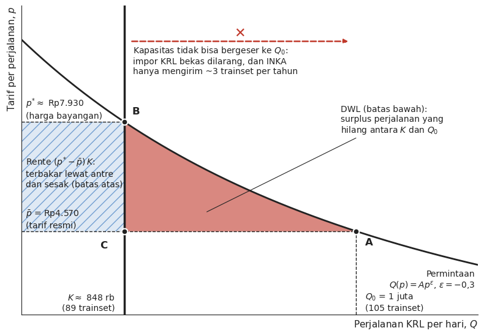

Barusan saya nonton [Jelasin Dong Tempo yang ini,](https://www.youtube.com/watch?v=7Kgv8JXxyGE) soal KRL, INKA, dan KAI. Isinya lumayan komprehensip: armada KRL yang kurang, INKA yang produksinya lambat dan utangnya numpuk, sampai rencana merger KAI–INKA. Buat saya, ini contoh yang pas banget buat ngobrolin satu instrumen kebijakan industri favorit pemerintah kita: **TKDN**, alias _local content requirement_ (LCR).

Dulu saya pernah [bikin model TKDN sederhana](). Kesimpulannya: TKDN itu tidak gratis, cuma ongkosnya tidak kelihatan di APBN. Kasus KRL ini enak buat dibedah karena ongkosnya bisa (kira-kira) dihitung, dan kita bisa lihat siapa yang bayar.

Spoiler: yang bayar anker, alias anak kereta.

## TKDN di kasus INKA

Di Indonesia, produsen sarana kereta **domestik** ya cuma INKA (BUMN). Jadi di pasar dalam negeri INKA adalah monopoli, dan pesaingnya cuma impor. Pembeli utamanya KAI dan anak usahanya, KAI Commuter (KCI), yang mengoperasikan KRL. Selama ini KCI menambal kebutuhan armada dengan **KRL bekas dari Jepang**, yang murah dan datengnya cepet.

Namun tahun 2023, jalur impor tersebut ditutup. KCI mengajukan impor 348 unit KRL bekas seri E217. Kemenperin [menolak memberi rekomendasi teknis](https://www.cnnindonesia.com/ekonomi/20230302082911-92-919704/alasan-kemenperin-tolak-beri-rekomendasi-izin-impor-krl-bekas-jepang) karena barang modal bukan baru itu tidak memenuhi syarat TKDN dan tidak sejalan dengan program Peningkatan Penggunaan Produk Dalam Negeri (P3DN). BPKP lalu mengaudit dan [juga tidak merekomendasikan impor](https://www.liputan6.com/bisnis/read/5253748/tok-impor-krl-bekas-jepang-resmi-ditolak). Alasan BPKP bukan cuma soal produksi dalam negeri: [biaya _handling_ dan pengapalan yang diajukan KCI dinilai tidak bisa diyakini](https://www.suara.com/bisnis/2023/04/06/124026/bpkp-temukan-kejanggalan-biaya-impor-krl-bekas), dan [armada yang ada (1.114 unit) dinilai masih cukup](https://nasional.kontan.co.id/news/hasil-review-bpkp-impor-krl-bekas-tak-direkomendasikan) karena penumpang 2023 masih jauh di bawah 2019. Jadi TKDN/P3DN adalah bagian dari konteks kebijakannya, bukan satu-satunya alasan. Opsi yang tersisa adalah retrofit KRL lama di INKA dan menunggu KRL baru buatan INKA ([kronologinya di sini](https://id.wikipedia.org/wiki/Polemik_impor_KRL_bekas_tahun_2023)). Akhirnya KCI memesan 16 rangkaian (_trainset_) baru dan retrofit dari INKA. Belakangan KCI juga diizinkan mengimpor KRL **baru** dari [CRRC (Tiongkok)](https://www.tempo.co/ekonomi/kai-klaim-92-persen-pengadaan-krl-bekerja-sama-dengan-inka-total-investasi-rp6-06-triliun-89355).

Jadi aturan mainnya kurang lebih: **beli dari INKA. Kalau terpaksa impor, harus baru, bekas tidak boleh.**

Tujuannya apa? Ini yang tidak pernah jelas. Membesarkan INKA? Ukurannya apa: aset, produksi, tenaga kerja, laba, atau _know-how_? Kalau memang tujuannya membesarkan INKA, pemerintah sebenarnya bisa memilih **subsidi**. Bedanya, subsidi butuh APBN dan kelihatan di Nota Keuangan, jadi harus dipertanggungjawabkan ke DPR. TKDN kelihatannya tidak butuh APBN sama sekali. Gratis.

Tapi beneran gratis?

## Siapa yang nanggung?

Yang pertama kena tentu KAI/KCI sebagai pembeli. Mereka harus membeli barang yang lebih mahal per tahun pakainya (dihitung di bawah) dan yang datangnya lebih lambat. Tapi KCI tidak bisa begitu saja meneruskan ongkos ini ke harga, karena **tarif KRL diatur pemerintah** dan disubsidi lewat PSO. Tarifnya masih Rp3.000 untuk 25 km pertama ditambah Rp1.000 per 10 km berikutnya, dan [rencana tarif berbasis NIK](https://finance.detik.com/berita-ekonomi-bisnis/d-7513056/subsidi-krl-berbasis-nik-di-2025-tarifnya-bakal-naik) pun belum jalan.

Kalau harga tidak bisa naik, penyesuaiannya lewat **kuantitas**. Menurut video tadi:

- KRL Jabodetabek melayani lebih dari **1 juta penumpang per hari**: sepanjang Januari–Agustus 2026 ada 277,3 juta penumpang, atau rata-rata sekitar 1,14 juta per hari ([KAI](https://www.kai.id/publikasi/siaran-pers/6-trainset-krl-ie305-kembali-beroperasi-kai-dan-inka-tuntaskan-perawatan-satu-trainset-terakhir)). Menurut video, jumlah perjalanan biasanya sekitar 1.065 per hari, dan sempat turun ke 1.048 pada September 2026, bersamaan dengan ditariknya 7 trainset buatan INKA untuk perawatan ([KAI](https://www.kai.id/publikasi/siaran-pers/6-trainset-krl-ie305-kembali-beroperasi-kai-dan-inka-tuntaskan-perawatan-satu-trainset-terakhir)).
- Untuk operasi normal dibutuhkan sekitar **105 trainset**, tapi yang beroperasi hanya sekitar **89**.
- INKA menargetkan 8 trainset per tahun, tapi realisasinya sekitar **3 per tahun**. Dari 16 trainset yang dipesan, per Januari 2026 baru 4 yang beroperasi ([Investortrust](https://investortrust.id/business/92535/kai-commuter-pastikan-12-trainset-inka-tiba-juni-2026-operasi-mulai-juli)). Per awal Oktober 2026, 7 trainset buatan INKA (seri iE305) sudah sempat beroperasi, tapi ketujuhnya harus ditarik untuk perawatan. 6 sudah kembali beroperasi dan 1 masih diselesaikan bersama INKA ([KAI](https://www.kai.id/publikasi/siaran-pers/6-trainset-krl-ie305-kembali-beroperasi-kai-dan-inka-tuntaskan-perawatan-satu-trainset-terakhir)).

Tapi bukankah BPKP bilang armada masih cukup? Itu penilaian 2023, ketika penumpang belum pulih dari pandemi. Pembandingnya waktu itu adalah 2019, saat 1.078 unit melayani 336,3 juta penumpang ([Kontan](https://nasional.kontan.co.id/news/hasil-review-bpkp-impor-krl-bekas-tak-direkomendasikan)). Sekarang penumpangnya sudah jauh melewati itu: 1,14 juta per hari kalau disetahunkan jadi sekitar 416 juta penumpang. Jadi penilaian "armada cukup" itu sudah tidak berlaku.

Memang keliatannya tidak pakai APBN, tapi ongkosnya muncul sebagai kereta yang kurang, jadwal yang dipangkas, dan gerbong yang makin sesak. Ongkos ini tidak tercatat di APBN, tapi tetap ditanggung oleh penumpang.

## Hitungan 1: berapa yang dibayar KAI?

Tabel 1 menyajikan harga per trainset untuk tiap opsi pengadaan, dalam miliar Rupiah, beserta asumsi umur pakainya. Harga INKA dan retrofit dihitung dari nilai kontrak KCI: 16 trainset baru senilai Rp3,83 triliun dan 19 trainset retrofit senilai Rp2,23 triliun ([Tempo](https://www.tempo.co/ekonomi/kai-klaim-92-persen-pengadaan-krl-bekerja-sama-dengan-inka-total-investasi-rp6-06-triliun-89355)). Angka per trainset hasil pembagian ini sama dengan yang disebut di Jelasin Dong (sekitar menit 17:45). Harga KRL bekas Jepang diambil dari video Jelasin Dong. Angka ini sejalan dengan anggaran KAI 2023 sebesar Rp150 miliar untuk 10 rangkaian bekas di ([Wikipedia](https://id.wikipedia.org/wiki/Polemik_impor_KRL_bekas_tahun_2023)). Harga CRRC adalah Rp783 miliar dibagi 3 trainset.

| Opsi | Harga per trainset (Rp M) | Asumsi umur pakai (tahun) |
|---|---:|---:|
| KRL bekas Jepang | 19,2 | 10 |
| Retrofit di INKA | 117,6 | 15 |
| KRL baru INKA | 239,3 | 30 |
| KRL baru CRRC | 261,0 | 30 |

<!--Video juga menyebut "KRL baru dari Jepang" seharga Rp25,6 miliar per trainset. Angka ini tidak saya pakai karena tidak masuk akal untuk 12 gerbong baru (bandingkan dengan CRRC) dan saya tidak menemukan sumber lain yang mengonfirmasinya.-->

Ada satu hal yang menarik: **harga KRL baru INKA ternyata tidak lebih mahal dari CRRC**. Jadi masalahnya bukan "INKA lebih mahal dari impor baru". Masalahnya ada di dua hal: (1) larangan impor **bekas**, dan (2) INKA **lambat** mengirim.

Tentu tidak adil membandingkan langsung harga kereta bekas dengan kereta baru, karena kereta bekas lebih cepat terdeperesiasi dan akibatnya jadi perlu lebih cepat diganti. Supaya _apple to apple_, kita hitung biaya per tahun pakai atau _equivalent annual cost_ (EAC):

$$
EAC = P \cdot \frac{r}{1-(1+r)^{-T}}
$$

di mana $P$ adalah harga beli per trainset, $T$ adalah umur pakai dalam tahun, dan $r$ adalah tingkat diskonto. Saya pakai $r$ = 7%, kira-kira setara imbal hasil SBN. Asumsi umur pakai di Tabel 1 sengaja saya buat merugikan opsi bekas: E217 buatan 1994–1999 saya kasih sisa umur cuma 10 tahun, padahal KRL bekas Jepang di Jabodetabek biasanya dipakai lebih lama.


```python
def eac(P, T, r=0.07):
    return P * r / (1 - (1 + r) ** -T)

opsi = {"KRL bekas Jepang": (19.2, 10), "Retrofit INKA": (117.6, 15),
        "KRL baru INKA": (239.3, 30), "KRL baru CRRC": (261.0, 30)}
for k, (P, T) in opsi.items():
    print(f"{k:18s} EAC = {eac(P, T):6.2f} miliar/tahun")
```

    KRL bekas Jepang   EAC =   2.73 miliar/tahun
    Retrofit INKA      EAC =  12.91 miliar/tahun
    KRL baru INKA      EAC =  19.28 miliar/tahun
    KRL baru CRRC      EAC =  21.03 miliar/tahun
    

Dengan asumsi umur pakai 10 vs 30 tahun dan kapasitas per trainset yang sama, per tahun pakainya KRL bekas **sekitar 7 kali lebih murah** daripada KRL baru INKA. Retrofit, yang digadang-gadang sebagai solusi "dalam negeri", per tahunnya hampir 5 kali lebih mahal dari bekas.

Sekarang kita terapkan ke kekurangan armada sebanyak 105 − 89 = 16 trainset. Kebetulan jumlahnya sama dengan pesanan KCI ke INKA:

- **Belanja di muka:** 16 × Rp239,3 M ≈ **Rp3,83 T** dari INKA, dibanding 16 × Rp19,2 M ≈ **Rp0,31 T** kalau bekas. Selisihnya sekitar **Rp3,5 T**.
- **Per tahun pakai:** selisihnya sekitar **Rp265 miliar per tahun**. Kalau sisa umur bekas 15 tahun, selisihnya malah sedikit lebih besar, sekitar Rp275 miliar per tahun.

Ada beberapa catatan biar adil. Kereta bekas biasanya butuh biaya tambahan sebelum bisa dipakai (misalnya ganti AC), dan perawatannya bisa lebih mahal. Spare part juga bisa jadi masalah. KAI sendiri bilang harga bukan satu-satunya pertimbangan: ada sisa umur, teknologi, ketersediaan suku cadang, perawatan, dan konsumsi energi. Hitungan EAC di atas juga **belum memasukkan** biaya perawatan, energi, persiapan impor atau retrofit, nilai sisa, serta perbedaan kapasitas dan keandalan. Jadi angka "7 kali" itu bergantung pada asumsi, bukan angka pasti. Tapi dengan selisih sebesar itu, biaya-biaya tambahan tersebut harus luar biasa mahal untuk menutup gap-nya.

Lalu dari mana uang Rp3,83 T itu? Sebagian dari **PMN**: Rp2 T pada 2024 dan Rp1,8 T pada 2025, plus rencana Rp1,5 T lagi pada akhir 2026 yang sampai sekarang masih proyeksi ([Investortrust](https://investortrust.id/business/92535/kai-commuter-pastikan-12-trainset-inka-tiba-juni-2026-operasi-mulai-juli)). Tapi hati-hati, ini **bukan** bukti bahwa TKDN makan APBN. Anggap saja KCI tetap butuh kereta dan tetap akan dapat PMN, mau belinya dari INKA atau bekas dari Jepang. Dengan anggapan itu, sumber dananya tidak relevan. Yang penting adalah **tambahan** ongkos akibat aturan TKDN, dan ini tergantung bagaimana PMN merespons:

1. **PMN tetap.** Dengan uang yang sama, harga per tahun pakai yang lebih mahal berarti kereta yang dibeli lebih sedikit. Seluruh ongkosnya jatuh ke penumpang, dan ini yang dihitung di bagian berikutnya.
2. **PMN ikut membesar menutup harga INKA.** Selisih belanjanya (sekitar Rp3,5 T di muka, atau Rp265 miliar per tahun pakai) secara efektif adalah **subsidi APBN ke INKA yang dititipkan lewat KAI**. Ongkosnya sama-sama ditanggung pembayar pajak seperti subsidi langsung, tapi tidak tercatat sebagai subsidi ke INKA dan tidak dikaitkan dengan target kinerja INKA apa pun. Lebih buruk dari subsidi langsung, karena tidak transparan.

Kenyataannya mungkin campuran keduanya. Lalu bagaimana dengan INKA sendiri, yang [utangnya sekitar **Rp4,7 T**](https://www.kabarbursa.com/makro/besok-danantara-mulai-lagi-lrt-city-inka-terbelit-utang-rp47-triliun) dan akan direstrukturisasi plus disuntik modal lewat Danantara dalam rangka [merger dengan KAI](https://jatim.antaranews.com/berita/1102836/dony-oskaria-sebut-merger-inka-dan-kai-rampung-sebelum-januari-2027), yang ditargetkan rampung sebelum Januari 2027? Suntikan ini tidak lewat APBN, jadi bukan subsidi langsung negara. Tapi ini trik lain untuk menopang INKA tanpa APBN, mirip yang terjadi pada BUMN Karya, dan sama buruknya dari sisi transparansi. Di post ini, ketika bilang "tidak butuh APBN", yang dimaksud adalah subsidi langsung negara. Jadi suntikan Danantara tidak saya hitung sebagai ongkos TKDN, meskipun ini menunjukkan kebijakan yang katanya gratis itu bahkan tidak berhasil membuat INKA sehat.

## Hitungan 2: berapa yang dibayar penumpang?

Ini bagian yang paling sering dilupakan. Karena tarif dipatok, kekurangan kereta tidak muncul sebagai kenaikan harga, tapi sebagai **penjatahan** (_rationing_): sebagian orang tidak kebagian layanan yang layak, sisanya berdesakan.

Pendekatannya mirip dengan [post JORR saya]() dulu: pakai kurva permintaan lalu hitung surplus konsumen yang hilang. Dibanding post itu, tho, saya nambah dua  perbaikan. Pertama, luasnya dihitung pakai integral, bukan didekati dengan segitiga (thanks AI). Kedua, saya kasih **batas bawah dan batas atas**, karena cara penumpang "membayar" penjatahan itu menentukan besar kecilnya ongkos.

Kurva permintaan perjalanan KRL diasumsikan berelastisitas konstan:

$$
Q(p) = A p^{\varepsilon}
$$

di mana $Q$ adalah jumlah perjalanan per hari, $p$ adalah tarif per perjalanan, $\varepsilon < 0$ adalah elastisitas harga permintaan, dan $A$ adalah konstanta skala. Elastisitas angkutan umum biasanya inelastis. Rule of thumb literatur jangka pendek adalah sekitar −0,3, dengan rentang −0,2 sampai −0,5[^1]. Ini rule of thumb untuk angkutan umum secara umum, bukan estimasi untuk KRL, dan elastisitas jangka panjang biasanya lebih besar. Saya tidak menemukan estimasi elastisitas KRL yang kredibel, jadi saya pakai rentang ini.

Hasil hitungan di bagian ini adalah **skenario ilustratif**, bukan estimasi yang terukur dari data. Asumsi-asumsinya:

- Tarif rata-rata $\bar{p}$ = Rp4.570 per perjalanan. Angka ini adalah pendapatan tiket KCI 2023 (Rp1,52 T) dibagi 331,9 juta penumpang ([Laporan Tahunan KCI 2023](https://kci.id/files/download/annual_report/FAAR_2023.pdf)), dan cocok dengan rata-rata jarak perjalanan sekitar 36 km. Kedua angka ini mencakup seluruh layanan KCI, bukan Jabodetabek saja, tapi Jabodetabek menyumbang 88% penumpang (290,9 dari 331,9 juta) dengan skema tarif yang serupa.
- Pada tarif $\bar{p}$, permintaan $Q_0$ = 1 juta perjalanan per hari (angka bulat, sedikit di bawah realisasi 2026), dan 105 trainset adalah armada yang dibutuhkan untuk melayaninya dengan standar normal.
- Dengan 89 trainset, kapasitas layanan standar hanya $K = \frac{89}{105} Q_0 \approx 848$ ribu perjalanan per hari.
- Kapasitas dianggap proporsional dengan jumlah trainset, dan semua perjalanan dianggap setara. Dua asumsi ini, bukan cuma elastisitas, yang membuat rentang hasilnya lebar.

Pada tarif $\bar{p}$, orang mau naik $Q_0$, tapi kapasitas cuma $K$. Harga bayangan (_shadow price_) $p^{*}$ adalah tarif yang membuat permintaan pas sama dengan kapasitas:

$$
p^{*} = \bar{p}\left(\frac{K}{Q_0}\right)^{1/\varepsilon}
$$

Dengan $\varepsilon = -0{,}3$, kita dapat $p^{*} \approx$ Rp7.900. Artinya, di margin ada penumpang yang sebenarnya rela bayar hampir dua kali tarif resmi, tapi tetap tidak kebagian layanan yang layak.

**Batas bawah: _deadweight loss_.** Kalau yang kebagian kursi adalah orang-orang yang paling butuh (penjatahan efisien), kerugiannya cuma surplus dari perjalanan yang hilang:

$$
DWL = \int_{K}^{Q_0} \left[P(q) - \bar{p}\right] dq
$$

di mana $P(q) = \bar{p}\,(q/Q_0)^{1/\varepsilon}$ adalah kurva permintaan inversnya.

**Batas atas (hipotetis): rente yang terbuang.** Di dunia nyata, KRL tidak dijatah ke yang paling butuh. KRL dijatah lewat siapa yang kuat berdiri dan desak-desakan, siapa yang datang paling pagi, dan siapa yang rela nunggu kereta berikutnya. Barzel (1974)[^2] menunjukkan bahwa kalau penjatahan dilakukan lewat antre atau waktu, selisih $(p^{*} - \bar{p})$ untuk setiap perjalanan yang terlayani **paling banyak** bisa habis "dibayar" dalam bentuk waktu dan kenyamanan yang hilang. Literatur juga menunjukkan penjatahan non-harga membuat barang jatuh ke orang yang salah (_misallocation_)[^3], dan kesesakan di kereta memang punya nilai rupiah yang nyata bagi penumpang[^4], meski belum ada kalibrasinya untuk KRL Jabodetabek. Jadi batas atasnya, yang sengaja dibuat ekstrem karena mengasumsikan seluruh rente habis untuk semua perjalanan, adalah:

$$
L^{atas} = DWL + (p^{*} - \bar{p})\,K
$$

Gambar 1 mengilustrasikan batas atas dan bawah dari kerugian yang dibayar konsumen. Sumbu horizontal adalah jumlah perjalanan KRL per hari $Q$, sumbu vertikal adalah tarif per perjalanan $p$ dalam Rupiah. Kurva hitam adalah permintaan $Q(p)$ dengan $\varepsilon = -0{,}3$, dikalibrasi dari asumsi di atas (tarif rata-rata Rp4.570 pada 1 juta perjalanan per hari). Garis vertikal tebal adalah kapasitas $K$ dengan 89 trainset. Sumbunya tidak mulai dari 0 supaya bidang-bidangnya kelihatan.


```python
import numpy as np
import matplotlib.pyplot as plt

eps, p, Q0, x = -0.3, 4570, 1e6, 89 / 105
K = x * Q0
pstar = p * x ** (1 / eps)
P = lambda q: p * (q / Q0) ** (1 / eps)          # kurva permintaan invers

ink, merah, biru = "#222222", "#c0392b", "#2c6fbb"
qlo, qhi, plo, phi = 0.78 * Q0, 1.08 * Q0, 2000, 11500
q = np.linspace(qlo, qhi, 400)

fig, ax = plt.subplots(figsize=(8, 5.6))
ax.plot(q / 1e3, P(q), color=ink, lw=2)

qd = np.linspace(K, Q0, 200)
ax.fill_between(qd / 1e3, p, P(qd), color=merah, alpha=0.6, lw=0)
ax.fill_between([qlo / 1e3, K / 1e3], p, pstar, color=biru, alpha=0.15, lw=0)
ax.fill_between([qlo / 1e3, K / 1e3], p, pstar, facecolor="none", edgecolor=biru,
                hatch="//", lw=0, alpha=0.6)

ax.axvline(K / 1e3, color=ink, lw=2.5)
ax.plot([Q0 / 1e3, Q0 / 1e3], [plo, p], color=ink, lw=1, ls="--")
ax.plot([qlo / 1e3, Q0 / 1e3], [p, p], color=ink, lw=1, ls="--")
ax.plot([qlo / 1e3, K / 1e3], [pstar, pstar], color=ink, lw=1, ls="--")

for X, Y, lab, dx, dy in [(Q0, p, "A", 6, -420), (K, pstar, "B", 5, 250), (K, p, "C", -16, -520)]:
    ax.plot(X / 1e3, Y, "o", color=ink, ms=7, mec="white", mew=1.5)
    ax.text(X / 1e3 + dx, Y + dy, lab, fontsize=12, fontweight="bold", color=ink)

fs = 10
ax.text(qlo / 1e3 + 3, p + 120, r"$\bar{p}$ = Rp4.570" "\n(tarif resmi)", fontsize=fs, color=ink)
ax.text(qlo / 1e3 + 3, pstar + 120, r"$p^{*}\approx$ Rp7.930" "\n(harga bayangan)", fontsize=fs, color=ink)
ax.text(K / 1e3 - 6, plo + 150, r"$K\approx$ 848 rb" "\n(89 trainset)", fontsize=fs, color=ink, ha="right")
ax.text(Q0 / 1e3 + 6, plo + 150, r"$Q_0$ = 1 juta" "\n(105 trainset)", fontsize=fs, color=ink, ha="left")
ax.text(qhi / 1e3 - 2, 3400, "Permintaan\n" r"$Q(p)=Ap^{\varepsilon}$, $\varepsilon=-0{,}3$",
        fontsize=fs, color=ink, ha="right", va="top")

ax.annotate("DWL (batas bawah):\nsurplus perjalanan yang\nhilang antara $K$ dan $Q_0$",
            xy=((K + 0.35 * (Q0 - K)) / 1e3, p + 0.3 * (P(K + 0.35 * (Q0 - K)) - p)),
            xytext=(0.99 * Q0 / 1e3, 7600), fontsize=fs, color=ink, ha="left",
            arrowprops=dict(arrowstyle="-", color=ink, lw=0.8))
ax.text(qlo / 1e3 + 3, (p + pstar) / 2 + 150,
        r"Rente $(p^{*}-\bar{p})\,K$:" "\nterbakar lewat antre\ndan sesak (batas atas)",
        fontsize=fs, color=ink, va="center")

ax.annotate("", xy=(Q0 / 1e3 - 4, 10400), xytext=(K / 1e3 + 4, 10400),
            arrowprops=dict(arrowstyle="-|>", color=merah, lw=1.8, ls="--"))
ax.text((K + Q0) / 2 / 1e3, 10450, "✕", fontsize=16, color=merah, ha="center", va="bottom",
        fontweight="bold")
ax.text(K / 1e3 + 6, 10300, "Kapasitas tidak bisa bergeser ke $Q_0$:\n"
        "impor KRL bekas dilarang, dan INKA\nhanya mengirim ~3 trainset per tahun",
        fontsize=fs, color=ink, ha="left", va="top")

ax.set_xlim(qlo / 1e3, qhi / 1e3)
ax.set_ylim(plo, phi)
ax.set_xticks([]); ax.set_yticks([])
ax.grid(False)
for s in ("top", "right"):
    ax.spines[s].set_visible(False)
for s in ("left", "bottom"):
    ax.spines[s].set_color(ink)
ax.set_xlabel("Perjalanan KRL per hari, $Q$", fontsize=11, color=ink, loc="right")
ax.set_ylabel("Tarif per perjalanan, $p$", fontsize=11, color=ink, loc="top")
fig.tight_layout()
plt.show()

```


    

    


Titik A adalah yang "diminta" pasar pada tarif resmi: dengan tarif $\bar{p}$, orang mau naik $Q_0$ = 1 juta perjalanan per hari, yang butuh 105 trainset. Titik B adalah harga yang menyamakan permintaan dengan kapasitas yang ada: kalau tarif bebas bergerak, ia naik ke $p^{*} \approx$ Rp7.930 dan kelebihan permintaan hilang. Yang terjadi di dunia nyata adalah titik C: tarif tetap $\bar{p}$ karena diatur negara, tapi layanan standar cuma $K$, sehingga ada kelebihan permintaan $Q_0 - K \approx$ 152 ribu perjalanan per hari.

Di pasar normal, kelebihan permintaan seperti ini dijawab lewat kuantitas: garis kapasitas bergeser ke kanan menuju $Q_0$. Di sini kuantitas tidak bisa menyesuaikan karena dua hal sekaligus. Impor KRL bekas dilarang, dan INKA tidak mampu mengirim trainset secepat yang dibutuhkan (3 dari target 8 per tahun). Jadi garis kapasitasnya macet di 89 trainset, harganya macet di $\bar{p}$, dan penyesuaiannya terpaksa lewat penjatahan.

Segitiga merah adalah klasik $DWL$ di kuliah mikroekonomi dasar: surplus dari perjalanan antara $K$ dan $Q_0$ yang hilang begitu saja dan tidak pindah ke siapa pun. Ini batas bawahnya. Persegi panjang biru bergaris adalah rente $(p^{*}-\bar{p})\,K$: surplus yang seharusnya dinikmati penumpang yang masih terlayani, tapi di bawah penjatahan lewat antre dan desak-desakan bisa habis terbakar. Batas atas $L^{atas}$ adalah jumlah keduanya. Kode di bawah menghitung luas kedua bidang itu untuk tiga nilai elastisitas.


```python
def biaya(eps, p=4570, Q0=1e6, x=89/105):
    K = x * Q0
    pstar = p * x ** (1 / eps)
    a = 1 + 1 / eps
    integral = p * Q0 * (1 - x ** a) / a      # ∫_K^Q0 P(q) dq
    dwl = integral - p * (Q0 - K)
    rente = (pstar - p) * K
    return pstar, dwl * 365 / 1e9, (dwl + rente) * 365 / 1e9

for e in (-0.2, -0.3, -0.5):
    ps, bawah, atas = biaya(e)
    print(f"eps={e}: p*=Rp{ps:,.0f}  bawah=Rp{bawah:,.0f} M/thn  atas=Rp{atas:,.0f} M/thn")
```

    eps=-0.2: p*=Rp10,445  bawah=Rp137 M/thn  atas=Rp1,954 M/thn
    eps=-0.3: p*=Rp7,930  bawah=Rp82 M/thn  atas=Rp1,122 M/thn
    eps=-0.5: p*=Rp6,361  bawah=Rp46 M/thn  atas=Rp600 M/thn
    

Dalam skenario ini, kekurangan 16 trainset kira-kira membebani penumpang **Rp46 miliar sampai Rp2 triliun per tahun**, dengan skenario tengah (ε = −0,3) di **Rp82 miliar sampai Rp1,1 triliun per tahun**. Rentangnya lebar, dan memang harus lebar karena asumsinya banyak. Ingat, ini hasil model dengan asumsi yang belum terverifikasi, bukan tagihan yang terukur ke penumpang. Yang bisa dikatakan dengan cukup yakin cuma arahnya: siapa pun yang pernah naik KRL jam 7 pagi dari Bogor tahu penjatahannya jelas bukan penjatahan efisien, jadi angka sebenarnya kemungkinan di atas batas bawah.

Berapa lama kekurangan ini berlangsung? Impor bekas ditolak awal 2023. KRL bekas bisa masuk dalam hitungan bulan, sedangkan pesanan INKA baru mulai berdatangan 2025–2026 dan masih ada yang terlambat. Ambil saja kira-kira 3 tahun, dengan asumsi kekurangan dan ongkosnya konstan selama itu. Totalnya berarti sekitar **Rp0,25 T sampai Rp3,4 T** untuk skenario tengah. Ongkos ini muncul sebagai layanan yang lebih padat dan terbatas. Siapa yang akhirnya menanggung ongkos fiskalnya bergantung pada pendanaan KAI/KCI, seperti dua kasus PMN di atas.

Bandingkan dengan selisih belanja KAI di atas, sekitar Rp265 miliar per tahun. Di batas bawah, ongkos di sisi penumpang memang lebih kecil dari itu. Tapi di batas atas, ongkos di sisi penumpang bisa sekitar 4 kali lipat ongkos di sisi pembeli. Rasio ini ilustratif saja, karena yang dibandingkan adalah kerugian kesejahteraan penumpang dengan selisih harga beli, dua besaran yang berbeda jenis. Poinnya bukan angka rasionya, tapi bahwa ongkos di sisi penumpang **bisa** sama besar atau lebih besar dari ongkos di sisi pembeli. Inilah yang tidak tertangkap model TKDN saya yang lama. Di model itu kuantitas dianggap tetap dan ongkosnya cuma margin produsen. Di dunia nyata, TKDN yang mengikat dan pemasok yang lambat juga memangkas **kuantitas**.

## Jadi, worth it ga?

Beberapa poin penting:

1. **TKDN tidak gratis.** Ia tidak muncul sebagai pos subsidi di APBN, tapi ongkosnya pindah ke pembeli (KAI/KCI) dan akhirnya ke penumpang lewat layanan yang lebih buruk. Kalau PMN ke KCI ikut membesar untuk menutup harga INKA, sebagian ongkos itu sebenarnya subsidi APBN ke INKA yang tersamar. Ditambah suntikan Danantara di luar APBN, dukungan ke INKA jadi tersebar di banyak kantong dan sulit dihitung totalnya.
2. **Ongkosnya tidak dibagi rata.** Kalau INKA disubsidi lewat APBN, ongkos industrialisasinya ditanggung semua pembayar pajak. Lewat TKDN, ongkosnya dipusatkan ke sekitar sejuta penumpang KRL per hari, yang sebagian besar naik kereta untuk **berangkat kerja**. Waktu dan tenaga yang habis di peron dan gerbong sesak adalah produktivitas yang hilang di kantor, pabrik, dan toko di Jabodetabek. Jadi kita memajaki aktivitas ekonomi paling produktif di negeri ini demi satu pabrik di Madiun.
3. **Bisa worth it, dengan syarat.** Literatur _infant industry_ menunjukkan bahwa proteksi **bisa** meningkatkan kesejahteraan kalau ada pembelajaran yang tidak bisa didapat pasar sendiri dan industrinya benar-benar jadi efisien, dan pilihan instrumennya ikut menentukan[^5]. Literatur kebijakan industri yang lebih baru juga menekankan disiplin, ukuran keberhasilan yang jelas, dan kesiapan menghentikan program yang gagal[^6]. Jadi pertanyaannya: apakah "surplus" yang dipindahkan dari anker ke INKA benar-benar dipakai untuk membangun kapasitas produksi dan _know-how_? Kalau INKA masih memproduksi 3 trainset per tahun dari target 8, terlambat mengirim, dan utangnya Rp4,7 T, buktinya sejauh ini belum ada. Lalu sampai kapan? Selama itu, anker mungkin bisa lebih produktif di sektor lain, sektor yang kebetulan sedang terhambat oleh transportasi.

Disclaimer dulu: meski saya percaya diri mengenai ilmu ekonomi, saya bukan ahli perkeretaan dan literally baru ngegali-gali soal kereta abis nonton video jelasin dong itu. Hitungan di post ini kasar bgt dan ga reliabel, jadi harus diterjemahkan dengan hati-hati. Namun meski kasar, logika perhitungannya mungkin masih cukup berguna. Kodenya ada di atas, semoga bisa jadi awalan untuk membangun model yang lebih sesuai dengan kalibrasi angka yang lebih baik.

Meskipun hitungan kita mungkin jauh dari sempurna, **hitungan harus tetap dilakukan**. Ga ada kebijakan yang gratis. Setiap intervensi pemerintah pasti ada ongkosnya. Yang berbeda cuma siapa yang bayar dan bagaimana cara ia membayarnya. Pembuat kebijakan yang mengabaikan ini dan merasa TKDN itu gratis sedang mempertontonkan iliterasi ekonomi.

Gitu dulu kali ya. Mention saya di [twitter](https://www.twitter.com/imedkrisna) yah jika ada komen, kritik, atau saran. Tengkyuu.

[^1]: Litman, T. (2004). Transit Price Elasticities and Cross-Elasticities. *Journal of Public Transportation*, 7(2), 37–58. https://doi.org/10.5038/2375-0901.7.2.3
[^2]: Barzel, Y. (1974). A Theory of Rationing by Waiting. *The Journal of Law and Economics*, 17(1), 73–95. https://doi.org/10.1086/466785
[^3]: Glaeser, E. L., & Luttmer, E. F. P. (2003). The Misallocation of Housing Under Rent Control. *American Economic Review*, 93(4), 1027–1046. https://doi.org/10.1257/000282803769206197
[^4]: Wardman, M., & Whelan, G. (2011). Twenty Years of Rail Crowding Valuation: Methods, Evidence and Lessons from British Experience. *Transport Reviews*, 31(3), 379–398. https://doi.org/10.1080/01441647.2010.519127
[^5]: Melitz, M. J. (2005). When and How Should Infant Industries Be Protected? *Journal of International Economics*, 66(1), 177–196. https://doi.org/10.1016/j.jinteco.2004.07.001
[^6]: Juhász, R., Lane, N., & Rodrik, D. (2024). The New Economics of Industrial Policy. *Annual Review of Economics*, 16, 213–242. https://doi.org/10.1146/annurev-economics-081023-024638
